# LIVE:GUARD Frontend

라이브 방송 채팅을 시청하고 관제하는 Vue 3 웹 앱입니다. 로그인 역할에 따라 **시청자**, **스트리머(채널 운영자)**, **시스템 운영자** 화면을 제공합니다. 프론트엔드는 `/api/**`로 백엔드와 통신하며, 채팅과 관제 이벤트는 SSE로 받습니다.

## 화면 — 실제 API 콘솔 캡처

아래 이미지는 **Mock 모드가 아닌 API 콘솔 화면**을 새로 캡처한 것입니다. 2026-10-26에 로컬 통합 스택의 `http://localhost:3000`에서 `VITE_USE_API=true`로 빌드한 프론트와 로컬 시드 계정으로 로그인했습니다. 데스크톱 뷰포트는 1440 × 900입니다. 방송·채팅 건수는 촬영 당시 로컬 DB의 값이며, 운영 환경의 성능이나 데이터량을 나타내지 않습니다. 촬영 시점에는 해당 방송에 표시할 채팅이 없어 빈 상태가 보입니다.

### 시청자

방송 영상, 실시간 채팅, 본인 메시지와 채팅·입장 제한 상태를 봅니다. 오른쪽 상단 별 모양의 시연 도우미는 단일 계정 채팅 장면을 실행할 수 있습니다.

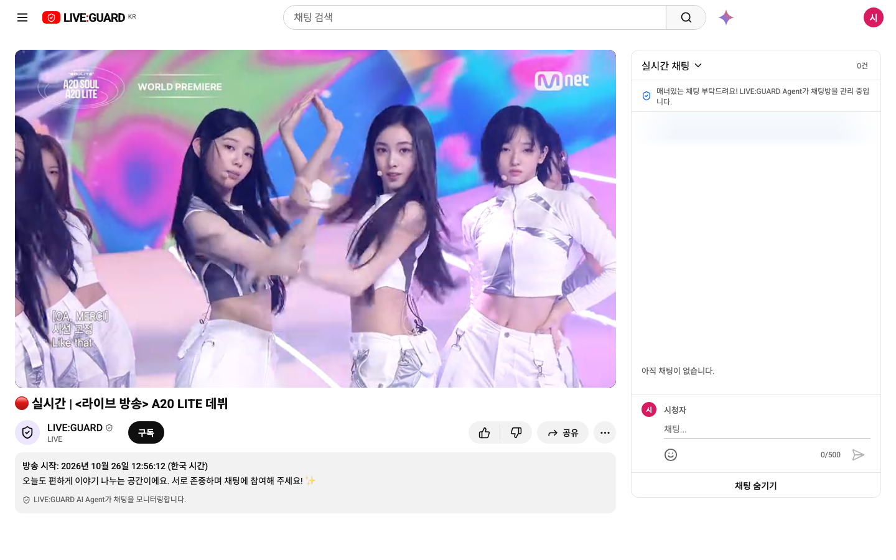

### 스트리머

`실시간 모니터링`에서 강퇴 승인 대기 → 문맥 검토 대기 → 실시간 채팅을 한 화면에 봅니다. `시청자 관리`, `기록`, `채팅 관제 운영 정책`은 왼쪽 서랍에서 이동합니다. 결정과 오판 취소 요청은 백엔드가 검증합니다.

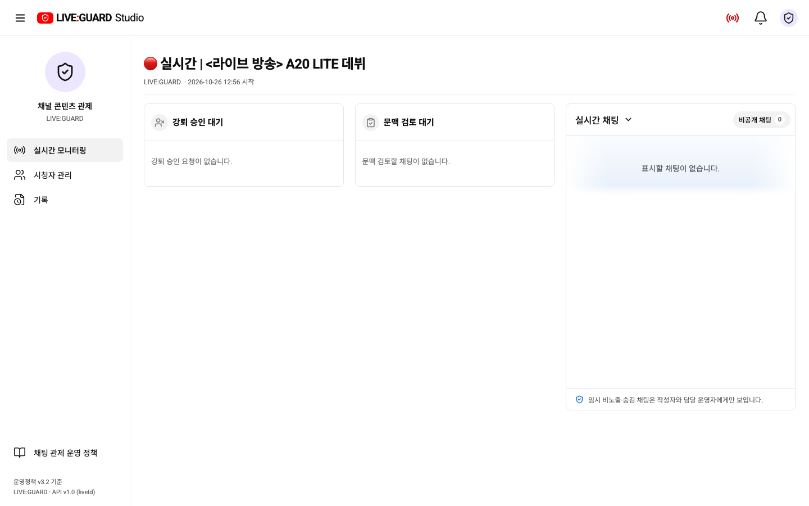

### 시스템 운영자

`실시간 관제`는 **방송 중인 채널**의 채팅·사건·검토를 조회합니다. `채팅관제 Tracking`에서는 방송을 고른 뒤 채팅의 처리 경로를 봅니다. 관리자 화면은 조회 전용이며 스트리머의 결정 화면과 권한이 다릅니다.

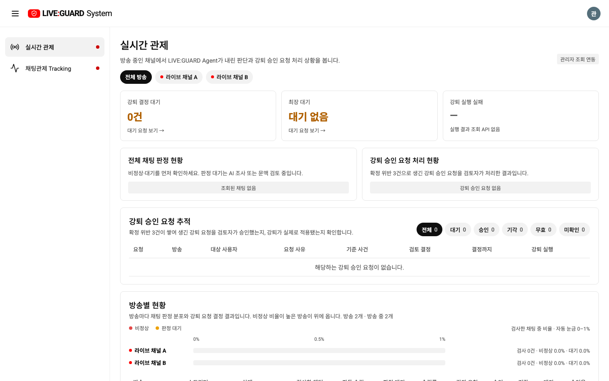

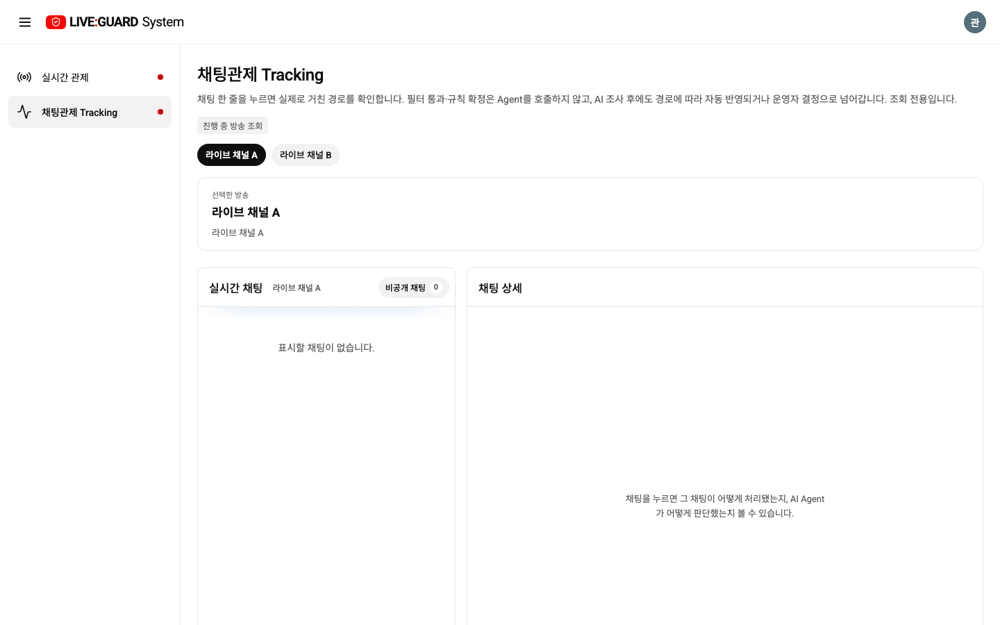

[API 콘솔 로그인 화면](docs/screenshots/api-console/login.png)도 함께 캡처했습니다. 로그인 배경의 말풍선은 화면 연출이며 서버 채팅이 아닙니다.

### 목업 화면

아래 표는 같은 날 `VITE_USE_API=false`로 실행한 **Mock 모드**를 1440 × 900에서 새로 캡처한 것입니다. 채팅·검토·통계 수치는 시연용 고정 데이터이며 API 응답이나 실제 관제 실적이 아닙니다.

| 화면 | Mock 모드 캡처 |
| --- | --- |
| 시청자 · 채팅 | 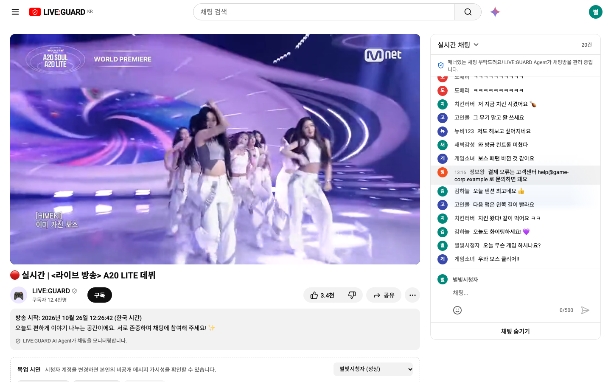 |
| 스트리머 · 실시간 모니터링 | 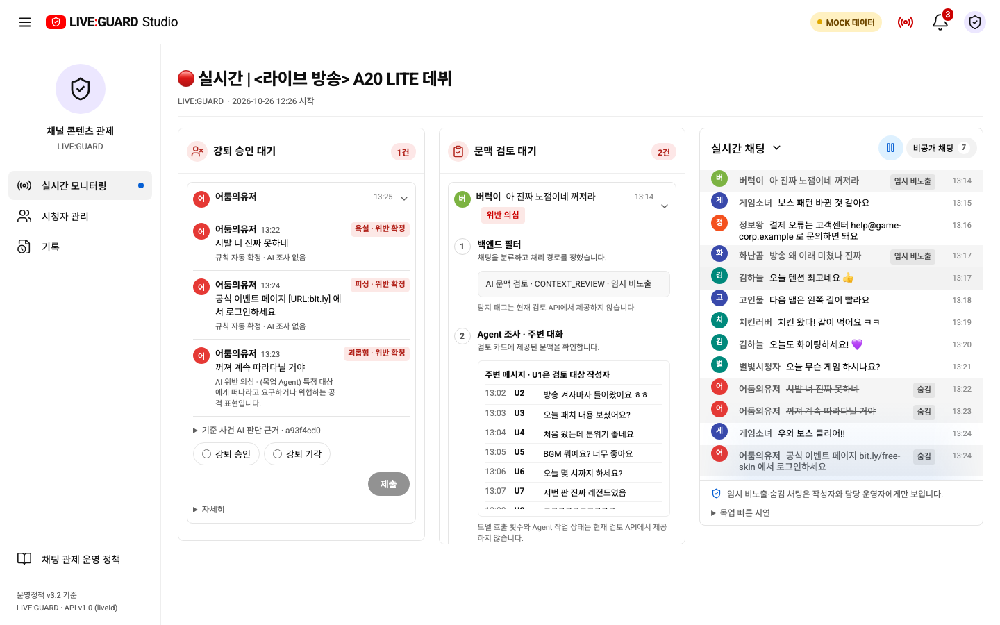 |
| 시스템 운영자 · 실시간 관제 | 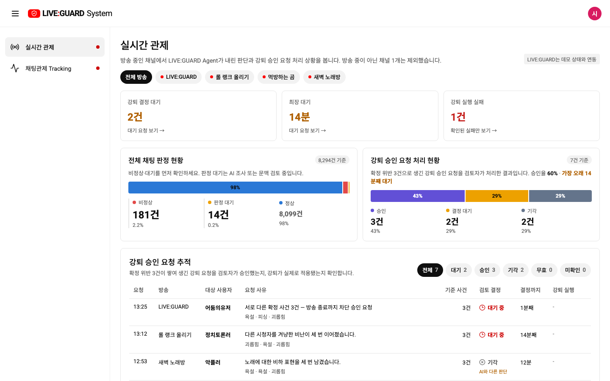 |
| 시스템 운영자 · 채팅관제 Tracking | 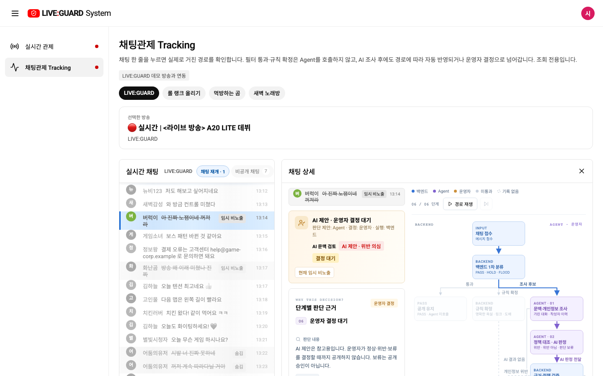 |

### 현재 제공 범위

| 역할 | Mock 모드 | API 모드 |
| --- | --- | --- |
| 시청자 | 방송·채팅·제재 시나리오 재현 | 실제 방송·채팅 조회와 전송, SSE, 본인 제재 상태 |
| 스트리머 | 판정·문맥 검토·강퇴 결정을 시연 | 방송 시작·종료, 채팅·사건·검토 조회, 결정·오판 취소 |
| 시스템 운영자 | 여러 방송 예시 데이터 조회 | `MONITOR` 권한으로 진행 중 방송의 채팅·사건·검토 조회 및 Tracking |

## 화면 사용법

아래 캡처도 `localhost:3000` **실제 API 콘솔**에서 찍었습니다.

| 기능 | 접속·사용 방법 | 화면 |
| --- | --- | --- |
| 시연 도우미 | 시청자 화면 상단 검색창 오른쪽의 **별 아이콘**을 누릅니다. 패널에서 `시연을 위해 목업 채팅을 만들어줘…` 버튼을 누르면 현재 로그인 계정으로 1초에 1개씩 최대 30개를 실제 전송합니다. 패널을 닫아도 계속 진행되며, 중단하려면 패널을 다시 열어 **중단하기**를 누릅니다. 욕설이 포함돼 채팅 제한이 적용될 수 있습니다. `demo-viewer 30명·60개` 장면은 Mock 모드 전용입니다. | [화면 보기](#시청자-시연-도우미-화면) |
| 서랍 탭 | **스트리머·시스템 운영자** 화면 왼쪽 위 **☰**를 누릅니다. 넓은 화면에서는 메뉴가 아이콘만 남도록 접히고, 다시 누르면 이름이 보입니다. 좁은 화면에서는 서랍이 열리며 항목을 고르면 해당 화면으로 이동합니다. | 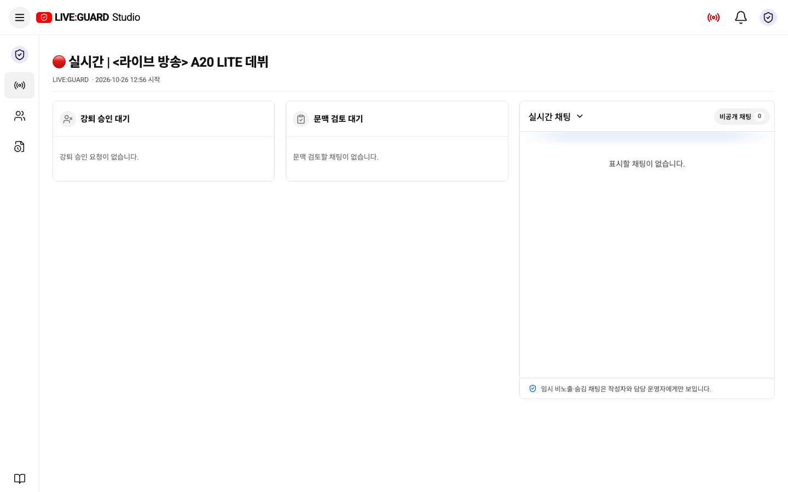 |
| 로그아웃 | 시청자·스트리머·시스템 운영자 모두 화면 **오른쪽 위 계정 아이콘**을 누릅니다. 열린 메뉴에서 계정 이름을 확인하고 **로그아웃**을 선택하면 로그인 화면으로 돌아갑니다. 별도의 로그아웃 화면은 없습니다. | 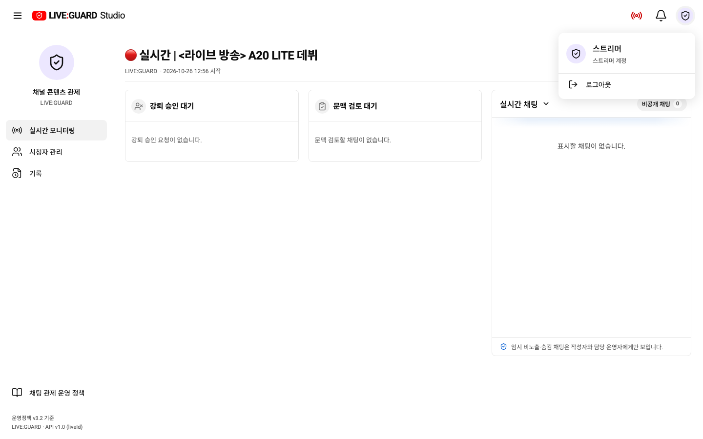 |

### 시청자 시연 도우미 화면

아래는 **실제 API 콘솔**에서 시청자로 로그인해 별 아이콘을 누른 장면입니다. 패널의 첫 번째 버튼은 현재 계정으로 채팅 30개를 전송합니다. 두 번째 `demo-viewer 30명·60개` 버튼은 Mock 모드에서만 사용할 수 있으므로 API 화면에서는 비활성화됩니다.

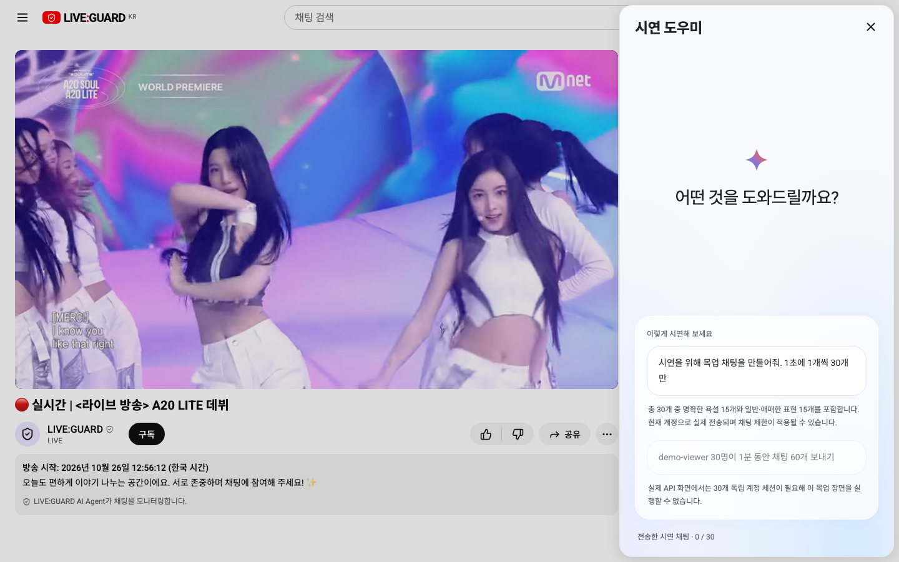

### 사람이 결정하는 관제 장면

스트리머의 **실시간 모니터링**은 왼쪽부터 강퇴 승인 대기, 문맥 검토 대기, 실시간 채팅 순서입니다. 아래 결정은 Mock 화면에서도 시연할 수 있으며, API 모드에서는 실제로 생성된 요청에만 적용됩니다.

| 장면 | 확인하고 처리하는 방법 |
| --- | --- |
| AI 문맥 검토 | **문맥 검토 대기**에서 채팅과 주변 대화, AI 판정 근거·정책을 확인합니다. **정상 확정·위반 확정·보류** 중 하나를 고른 뒤 제출합니다. AI의 답은 제안이며 최종 문맥 판단은 스트리머가 합니다. 보류한 채팅은 승인 없이 공개되지 않습니다. |
| 강퇴 승인 | **강퇴 승인 대기**에서 같은 시청자의 기준 사건 채팅 3건과 각각의 판정 상태를 확인하고 **강퇴 승인·강퇴 기각**을 선택해 제출합니다. 승인 응답만으로 실제 강퇴가 완료된 것은 아닙니다. 백엔드가 기준 사건을 재검증하고 실행한 결과를 별도로 확인해야 합니다. |


### 제재받은 시청자에게 보이는 화면

아래 두 장면은 **Mock 모드**에서 같은 시청자 `어둠의유저`의 화면을 캡처한 것입니다. 첫 화면에는 욕설 등으로 숨겨진 **본인 채팅과 제재 사유**, 채팅 제한 종료 시각이 표시됩니다. 이 메시지는 본인과 권한 있는 운영자에게만 보입니다. 두 번째 화면은 스트리머가 강퇴를 승인한 뒤 **목업에서 실행 성공까지 시뮬레이션한 상태**입니다. 영상 대신 이용 제한 안내가 나오고 이번 방송의 시청·채팅이 막힙니다. 승인만 한 상태에서는 이 화면으로 바뀌지 않습니다.

| 욕설 제재·채팅 제한 | 강퇴 실행 후 시청 제한 |
| --- | --- |
| 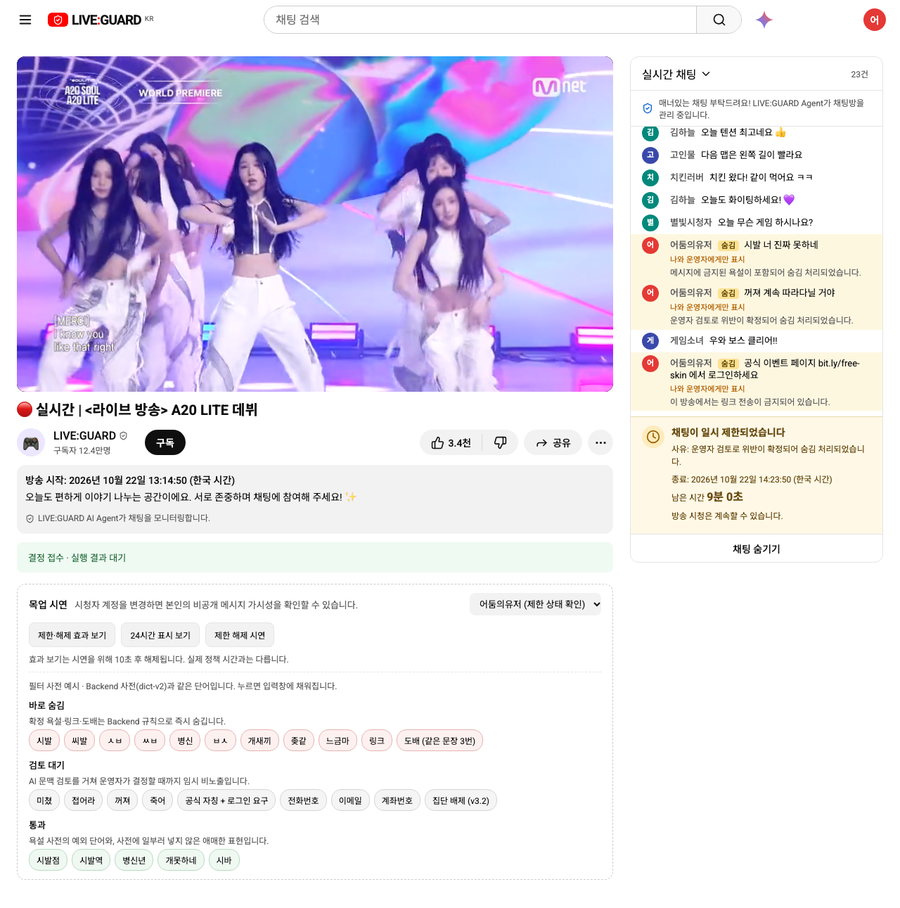 | 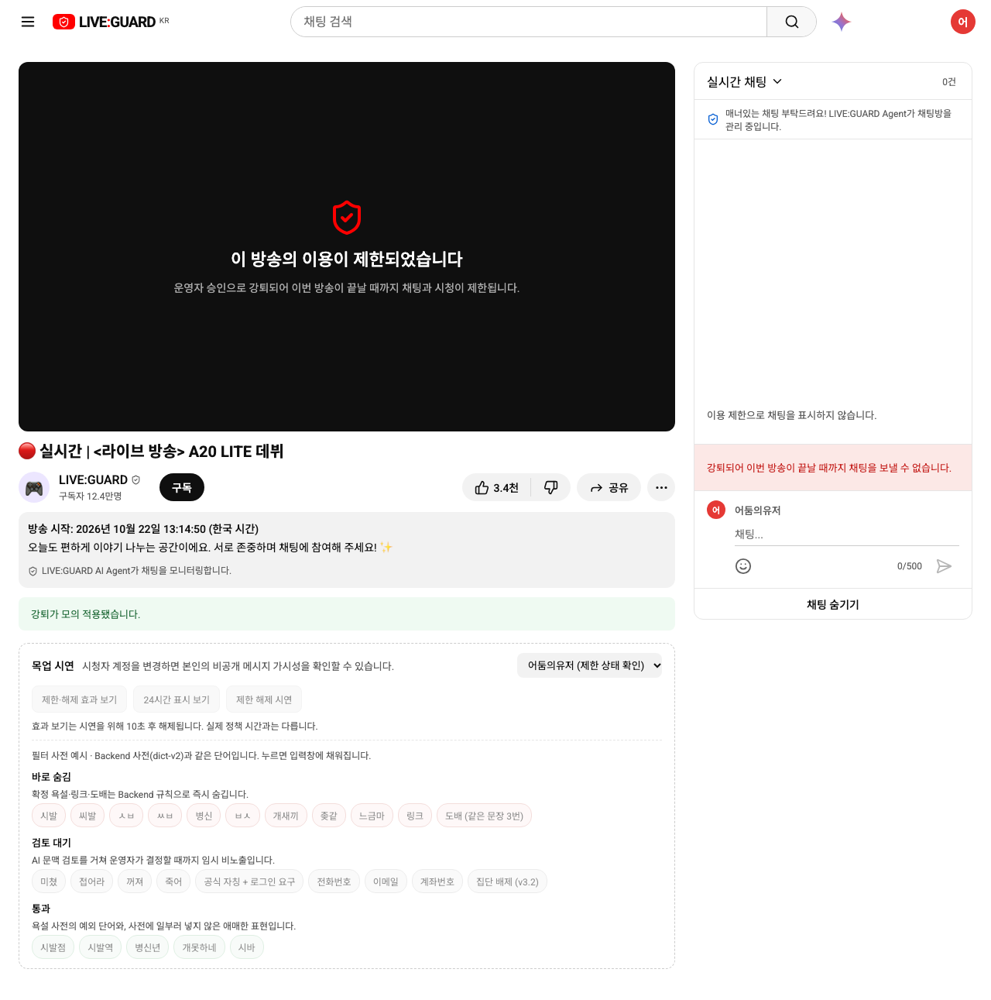 |

### 시스템 운영자 조회와 채팅 추적

시스템 운영자의 **실시간 관제**에서는 진행 중인 방송을 선택해 채팅 판정, 문맥 검토, 강퇴 요청을 살펴봅니다. 강퇴 요청은 **결정 상태(대기·승인·기각 등)**와 **실제 실행 결과**를 따로 확인합니다. 승인과 실행을 같은 상태로 취급하지 않으며, 실행 결과가 조회되지 않으면 완료로 단정하지 않습니다. 관리자 화면은 조회 전용입니다.

**채팅관제 Tracking**에서 방송을 고르고 채팅 한 줄을 선택하면 채팅 상세, 단계별 판단 근거, 백엔드·Agent·운영자를 거친 처리 경로와 상태 변경 기록이 나타납니다. 선택 중에는 목록이 자동으로 올라가지 않고 다른 채팅이 흐리게 표시됩니다. 새 채팅은 계속 수신되며 **채팅 재개**를 누르면 다시 최신 목록으로 돌아갑니다. 실제 API에서 조회되지 않은 Agent 근거·강퇴 실행 결과는 임의로 채워 넣지 않습니다.

비공개 채팅과 주변 대화의 열람은 백엔드 권한 검사와 마스킹 범위를 따릅니다. 이 화면이 모든 데이터 누수를 막는다고 단정할 수는 없으며, 관리자 조회 권한과 시청자에게 노출되는 데이터의 분리는 API 권한 검사 및 역할별 응답으로 검증해야 합니다.


## 빠른 실행

**요구 환경:** Node.js 20 이상. `.nvmrc`는 팀에서 쓰는 버전을 가리킵니다.

```bash
npm ci
npm run dev
```

기본값은 **Mock 모드**이며 `http://localhost:5173`에서 열립니다. 화면과 시나리오는 백엔드 없이 확인할 수 있습니다.

실제 백엔드가 `http://localhost:8080`에서 실행 중이면 API 모드로 시작합니다.

```bash
VITE_USE_API=true npm run dev
```

Vite는 브라우저의 `/api` 요청을 백엔드로 프록시합니다. `.env.example`을 `.env.local`로 복사하면 모드와 대상 주소를 고정할 수 있습니다. `VITE_` 변수는 브라우저에 노출되므로 비밀번호·API 키를 넣지 마세요.

| 변수 | 기본값 | 용도 |
| --- | --- | --- |
| `VITE_USE_API` | `false` | `true`면 실제 API, 그 외는 Mock |
| `VITE_BACKEND_TARGET` | `http://localhost:8080` | Vite 개발 서버의 `/api` 프록시 대상 |
| `VITE_API_BASE_URL` | 빈 값 | 별도 API 주소가 필요할 때만 설정 |
| `VITE_STREAM_SRC`, `VITE_STREAM_POSTER` | `public/media`의 기본 파일 | 시연 영상·포스터 |
| `VITE_DEMO_WIFI_NAME` | `SKALA 4층 Wi-Fi` | 접속 안내에 표시할 행사 Wi-Fi 이름 |

### 전체 스택과 로컬 계정

DB·Backend·Agent·MCP·Frontend를 함께 실행할 때는 [liveguard-infra README](https://github.com/skalaP05-03-261019/liveguard-infra)를 따르세요. 현재 infra Compose는 검증된 `BUSINESS_MCP_IMAGE` 값이 필요합니다. 해당 저장소의 `.env.example`과 README를 확인한 뒤 실행합니다. 통합 스택의 프론트 기본 주소는 `http://localhost:3000`입니다.

로컬 시드 계정은 아래와 같습니다. API 모드에서 계정은 Backend `local` 프로파일에 시드되어 있어야 합니다.

| 역할 | 아이디 | 로컬 시드 비밀번호 |
| --- | --- | --- |
| 시청자 | `viewer` | `liveguard-local` |
| 스트리머 | `moderator` | `liveguard-local` |
| 시스템 운영자 | `admin` | `liveguard-local` |

역할을 동시에 확인할 때는 **서로 다른 브라우저 프로필** 또는 서로 다른 호스트를 사용하세요. 같은 호스트는 포트가 달라도 로그인 쿠키를 공유합니다. 프론트를 수정한 후 3000번 컨테이너에 반영하려면 infra 폴더에서 프론트만 재빌드합니다.

```bash
docker compose up -d --build --no-deps frontend
```

## 채팅 관제 흐름

```text
시청자 채팅
  └─ Backend 1차 필터
      ├─ 통과 → 공개
      ├─ 규칙으로 확정된 위반 → 자동 숨김·제한
      └─ 문맥 조사가 필요한 사건 → Agent 제안 → Backend 검증
          ├─ 정책상 자동 처리 가능한 결과 → 상태 반영
          └─ 운영자 결정이 필요한 결과 → 문맥 검토 대기

최근 24시간의 서로 다른 확정 위반 사건 3건
  → 강퇴 승인 요청 → 스트리머 승인 → Backend 재검증 → 이번 방송 종료까지 제한
```

**Agent가 본 모든 채팅이 운영자 승인으로 가는 것은 아닙니다.** 규칙 확정과 자동 반영 경로가 있고, 문맥 검토와 강퇴 승인에는 운영자 결정이 필요합니다. 구현 기준은 [운영정책 v3.2](https://github.com/skalaP05-03-261019/liveguard-be/blob/main/docs/policy/POLICY.md)와 [Backend OpenAPI](https://github.com/skalaP05-03-261019/liveguard-be/blob/main/contracts/openapi.yaml)입니다.

## 주요 API 연결

호출은 [`src/api/client.ts`](src/api/client.ts)에 모여 있습니다.

| 용도 | 경로 |
| --- | --- |
| 세션 | `GET /api/auth/me`, `POST /api/auth/login`, `POST /api/auth/logout` |
| 채널·방송 | `GET /api/channels`, `GET /api/channels/{channelId}/lives/current` |
| 채팅 | `GET·POST /api/lives/{liveId}/messages`, `GET /api/lives/{liveId}/events` |
| 관제 | `GET /api/guard/events?liveId=`, `GET /api/cases?liveId=`, `GET /api/reviews?liveId=&kind=` |
| 스트리머 결정 | `POST /api/context-reviews/{reviewId}/decision`, `POST /api/kick-reviews/{reviewId}/decision` |
| 오판 취소 | `POST /api/findings/{findingId}/revoke` |

인증은 세션 쿠키와 CSRF 토큰을 사용합니다. 비공개 채팅의 열람 범위와 마스킹은 Backend 권한 검사 결과를 따릅니다. 관리자 `MONITOR`는 여러 채널을 조회할 수 있지만 그 권한만으로 결정 버튼이 생기지는 않습니다.

## 검증과 프로젝트 안내

```bash
npm run build          # TypeScript 검사 + 프로덕션 빌드
npm run test:chat      # 채팅·역할 화면 회귀 테스트
npm run test:contracts # API 계약 정렬 검사
```

| 경로 | 역할 |
| --- | --- |
| `src/ViewerScreen.vue`, `src/StudioScreen.vue`, `src/SystemPage.vue` | 역할별 화면. Mock과 API가 같은 화면 컴포넌트를 사용 |
| `src/LiveConsole.vue`, `src/api/client.ts` | API 화면의 REST·SSE 연결 |
| `src/ViewerAssistant.vue` | 시연 도우미 |
| `src/PeriodStats.vue`, `src/periodMock.ts` | 숨겨 둔 기간 통계 화면과 목업 데이터 |
| `src/contracts.ts`, `src/sanction.ts` | API 타입·라벨, 정책 기준 |
| `docs/screenshots/api-console/`, `docs/screenshots/mock-console/` | 이 README의 API 콘솔·목업 캡처 |

더 자세한 통합 절차와 검증 결과는 [API 통합 기록](docs/live-v1-integration.md), [검토·제재 흐름](docs/review-flow.md), [참여형 데모 안내](docs/participatory-demo.md)를 참고하세요. 데모 영상(`public/media/live-stream.mp4`)은 [Mnet M2의 A2O LITE - NEON 영상](https://www.youtube.com/watch?v=93j1fDGi_-8) 일부를 사용합니다. (To. 팀원께 외부 공개 시에는 사용 권한을 확인하거나 허가된 영상으로 교체하세요.)
