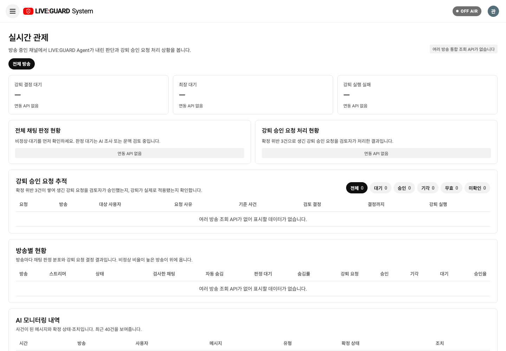
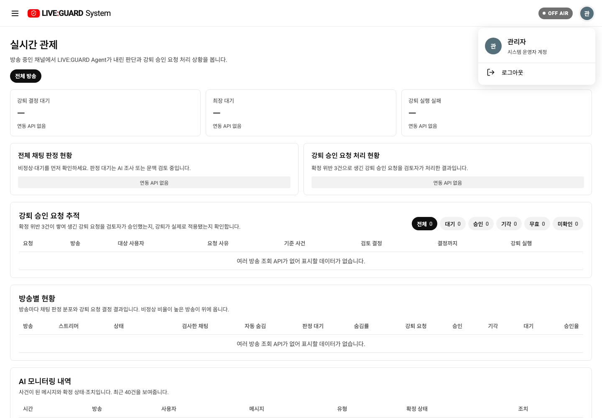
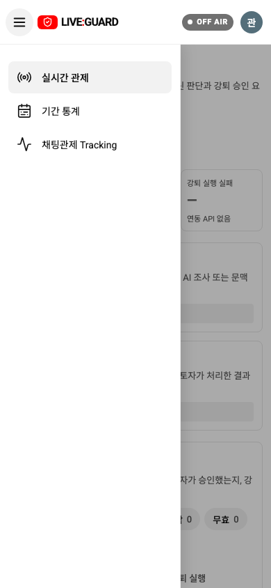
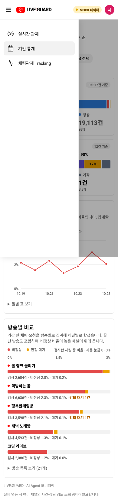
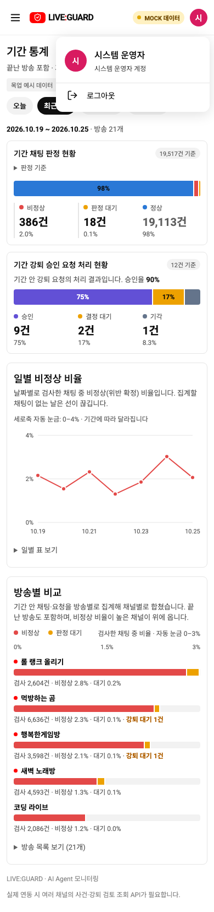

# 관리자 메뉴 서랍·계정 메뉴

관리자 화면의 고정 메뉴와 헤더의 닉네임·로그아웃을 스트리머 Studio와 같은 탐색 방식으로 정리했습니다. 목업과 실제 API 화면은 같은 SystemPage/AccountMenu를 사용합니다.

## 동작과 이유

- 1100px 이상: 왼쪽 메뉴를 기본 표시하고 햄버거로 접거나 펼칩니다. 접으면 본문이 넓어지며 선택한 탭과 필터는 유지합니다.
- 1100px 미만: 메뉴를 기본 숨기고 햄버거로 서랍을 엽니다. 실시간 관제·기간 통계·채팅관제 Tracking을 그대로 제공합니다. 탭 선택 후 서랍을 닫고 본문에 초점을 옮깁니다.
- Esc 또는 배경 클릭으로 닫고 메뉴 버튼에 초점을 돌립니다. 닫힌 메뉴는 접근성 트리/키보드 탐색에서 제외합니다. 서랍을 열면 뒤쪽 본문은 조작되지 않습니다. 움직임 줄이기 설정도 따릅니다.
- 관리자 닉네임과 로그아웃은 계정 아이콘 클릭 후 표시합니다. 기존 스트리머 AccountMenu를 재사용하고 계정 설명만 ‘시스템 운영자 계정’으로 전달합니다. Google 로그인이나 프로필 API를 추가한 것은 아니며 현재 계정의 닉네임 첫 글자를 대체 아바타로 사용합니다.
- 인증·권한·API·ERD·운영 정책은 변경하지 않습니다. 실제 API의 미지원 관리자 통계는 ‘연동 API 없음’으로 유지합니다.

## 캡처

실제 localhost:3000 API 콘솔: 메뉴를 접은 데스크톱

실제 API 콘솔: 계정 아이콘을 누른 상태

실제 API 콘솔: 390px 메뉴 서랍

목업: 동일한 서랍과 계정 메뉴(차트 수치는 시연 데이터)

## 검증

- 프로덕션 TypeScript/Vite 빌드 통과. Docker frontend만 재빌드하여 localhost:3000 반영.
- 목업/API fixture의 관리자 메뉴 신규 브라우저 테스트 2개 통과: 데스크톱 접기·펼치기, 360/390px 탭 선택, Esc/초점 복귀, 닉네임·로그아웃 숨김, 계정 메뉴 로그아웃.
- 기존 관리자 필터·모바일 행 상세·차트 테스트 통과.
- 실제 로컬 API 로그인으로 서랍·계정 메뉴·기간 통계의 빈 상태·390px 가로 넘침 없음 확인.
- 최종 전체 브라우저 회귀 테스트 `npm run test:chat`: **76/76 통과**.
