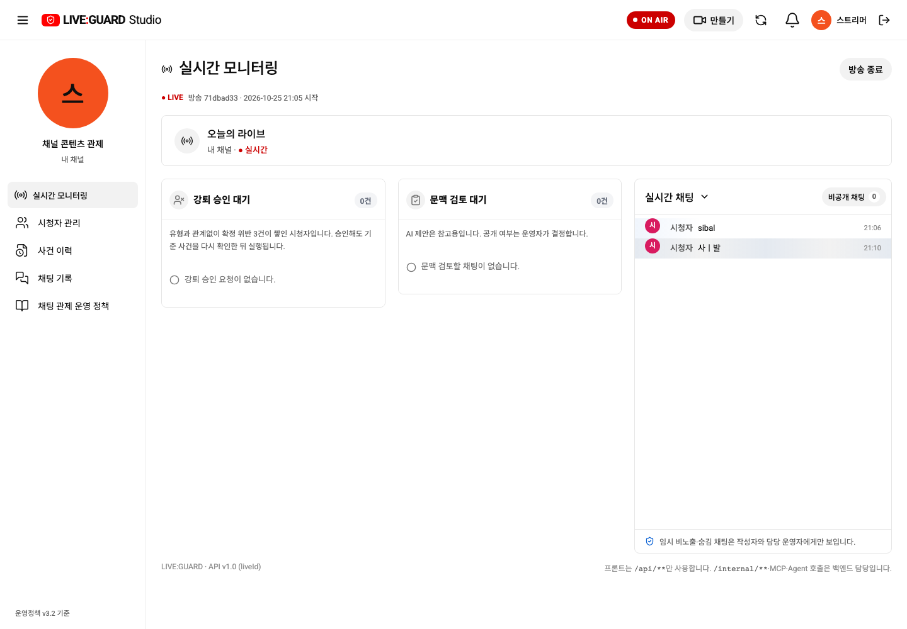
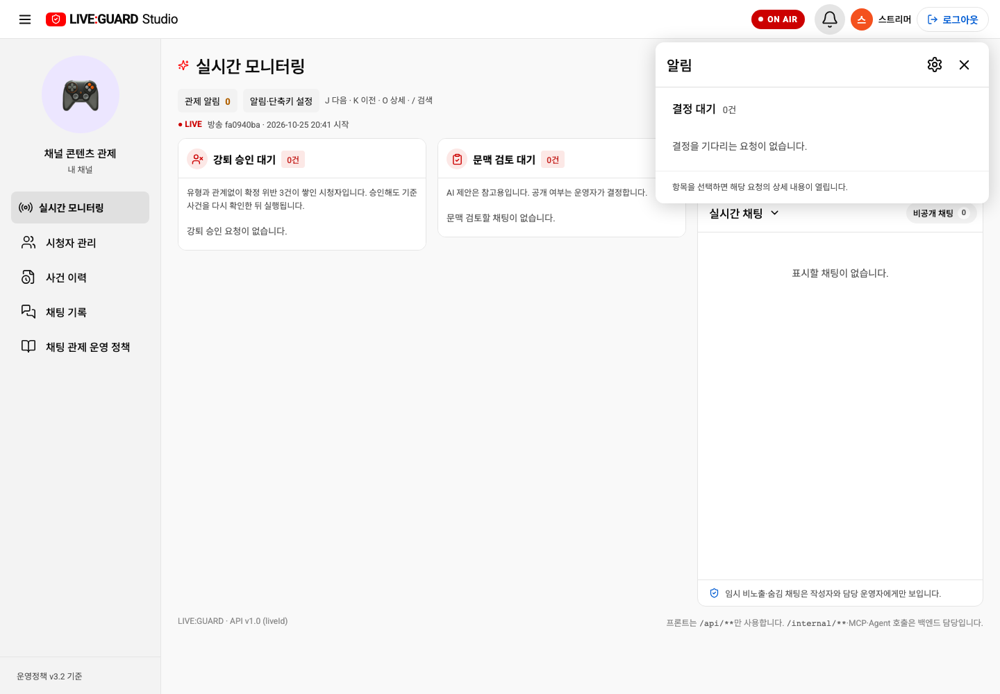
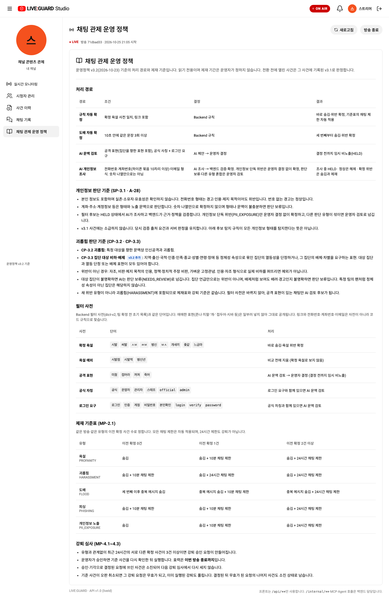
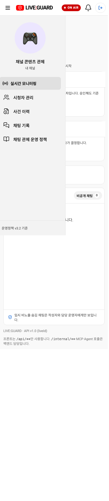
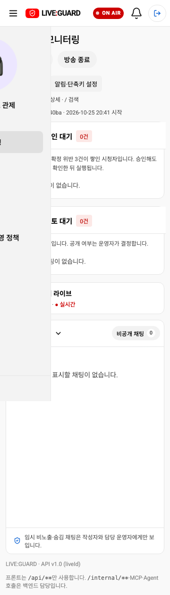
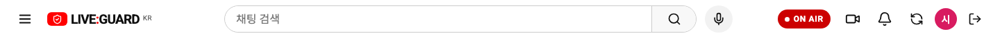
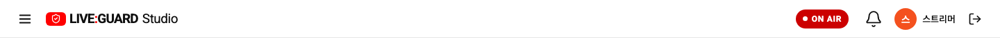
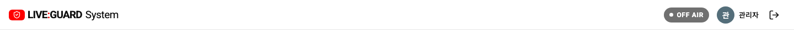

# localhost:3000 API 콘솔 반영 점검

2026-10-25 현재 작업 브랜치의 공통 UI를 로컬 Docker API 콘솔에 빌드하고, 실제 로컬 시드 스트리머 계정으로 로그인해 확인했습니다. 브라우저의 API 응답을 목업으로 바꾸지 않은 실제 화면입니다. 검토 요청·방송 시작/종료·제재 데이터를 생성하거나 변경하지 않았습니다.

## 원인과 반영

5173번 Vite 개발 서버는 소스 변경을 바로 반영하지만, 3000번은 Docker 안의 정적 빌드를 제공합니다. 이전 3000번 자산에는 종·통합 화면·OFF AIR 코드가 없었습니다. 프론트엔드만 `docker compose build frontend`와 `docker compose up -d --no-deps frontend`로 갱신했습니다. 빌드 소스는 `liveguard-fe`, `VITE_USE_API=true`입니다. BE·Agent·DB는 재시작하지 않았습니다.

현재 3000번 자산은 `/assets/index-DljcV8zz.js`이며 종·통합 화면·OFF AIR 코드가 포함돼 있습니다. 향후 프론트 소스를 수정해도 Docker는 자동 갱신되지 않으므로 3000번 반영을 다시 확인해야 합니다.

## 실제 API 화면 체크

| 오늘 변경한 항목 | 확인 결과 |
| --- | --- |
| 메뉴 통합 | 실시간 모니터링 한 개, 별도 결정 대기 메뉴 없음 |
| 3열 | 상단 방송 정보 아래 강퇴 승인 대기 / 문맥 검토 대기 / 실시간 채팅 순서로 동시 표시 |
| 종 알림 | 우상단 스트리머 프로필·이름 왼쪽에 종 표시. 대기 0건에서 클릭 시 빈 상세 목록 표시 |
| 알림 설정 | 톱니바퀴로 기존 알림·단축키 설정 열림 |
| 정책 문구 | ‘채팅 관제 운영 정책’, v3.2 SP-3.1·A-28 및 CP-3.3 안내 표시 |
| OFF AIR | 현재 실시간 연결 시 ON AIR. 검사 브라우저만 SSE를 차단해 회색 OFF AIR 표시 확인 |
| 휴대폰 | 390·360px 문서 가로 넘침 없음 |
| 런타임 오류 | 검사 브라우저 pageerror 0건 |

새 요청 효과 코드는 API 콘솔과 목업이 함께 사용하는 StudioScreen에 있습니다. 초기 목록/중복 제외, API/SSE로 새 요청 수신 후 강조, 종료 시 제거는 기존 API 모드 회귀 테스트에서 확인했습니다. **현재 실제 방송의 검토 요청은 0건이므로 실제 업무 데이터를 만들어 효과를 발생시키지는 않았습니다.** 효과 캡처는 [통합 화면 보고서](unified-live-monitoring.md)의 명시된 테스트 픽스처를 참고합니다.

실제 API의 판정·집계는 서버 응답을 사용합니다. FE 정책 안내가 표시된다는 사실이 BE·Agent/RAG의 정책 전환이나 미구현 기간 집계 API까지 검증됐다는 의미는 아닙니다. Backend 기간 통계 API는 기존 미연동 상태를 유지하며 임의 수치를 표시하지 않습니다.

## 실제 API 콘솔 캡처

정책 페이지

390·360px

SSE 차단은 검사 브라우저에만 적용했습니다. 실행 중인 방송·서버 연결을 중단하지 않았습니다.

## 로그아웃 아이콘 통일

스트리머와 시스템 운영자의 텍스트·파란 테두리 버튼을 시청자와 같은 `yt-icon-button` + 20px LogOut으로 통일했습니다. 툴팁과 접근성 이름은 로그아웃으로 유지하고 실제 로그아웃 핸들러는 변경하지 않았습니다. 목업/API 관련 기존 브라우저 테스트 4개와 빌드를 통과했습니다. Docker 갱신 후 실제 세 역할로 로그인해 모두 40×40px 버튼·20px 아이콘·텍스트 없음으로 확인했습니다.

시청자:

스트리머:

시스템 운영자:

상단 관제 알림·설정 버튼·단축키 안내·노란 배너를 제거한 화면으로 캡처를 갱신했습니다. 설정은 종의 톱니바퀴로 접근합니다. 3000번 재빌드 후 종 상세·설정과 360/390px 가로 넘침 없음을 실제 로그인으로 확인했습니다.

YouTube Studio 참고 스타일을 운영자 두 화면에 적용했습니다. 흰 작업 공간·사이드바·연회색 선택 메뉴·얇은 테두리·정돈된 글자와 간격의 전후 비교는 [스타일 반영 보고서](studio-reference-style.md)를 참고합니다. 실제 API 콘솔 재빌드와 두 운영자 역할 로그인·모바일 확인을 마쳤습니다.

강퇴·문맥 대기열에 공통 상태 요약 위젯을 적용했습니다. 실제 API의 0건은 회색 아이콘·배지·빈 안내로 확인했고, 0→1 경고 전환은 격리 API/SSE 테스트로 검증했습니다. 상세는 [위젯 보고서](status-summary-widget.md)를 참고합니다.

우상단 만들기 메뉴·라이브 스트리밍 시작을 추가했습니다. 실제 API 화면에서 메뉴와 방송 중 중복 시작 방지를 확인했습니다. 성공·실패는 격리 API 픽스처로 검증했으며 진행 중인 방송은 변경하지 않았습니다. [동작 범위와 캡처](stream-create-menu.md).

시청자 헤더의 영상/알림/새로고침을 제거하고 스트리머 헤더에 기존 만들기·종과 새로고침으로 통합했습니다. 실제 세 역할 로그인으로 시청자 0개·스트리머 각 1개를 확인했습니다. [역할별 캡처](role-header-controls.md).

스트리머의 직접 닉네임·로그아웃 표시는 제거하고 계정 아이콘을 눌렀을 때 표시되는 메뉴로 이동했습니다. 실제 API에서 헤더 닉네임/로그아웃 0개, 계정 메뉴 안의 닉네임·로그아웃, 모바일 배치를 확인했습니다. 시청자·시스템 운영자는 기존 헤더를 유지합니다. [최종 계정 메뉴 캡처](streamer-account-menu.md).
