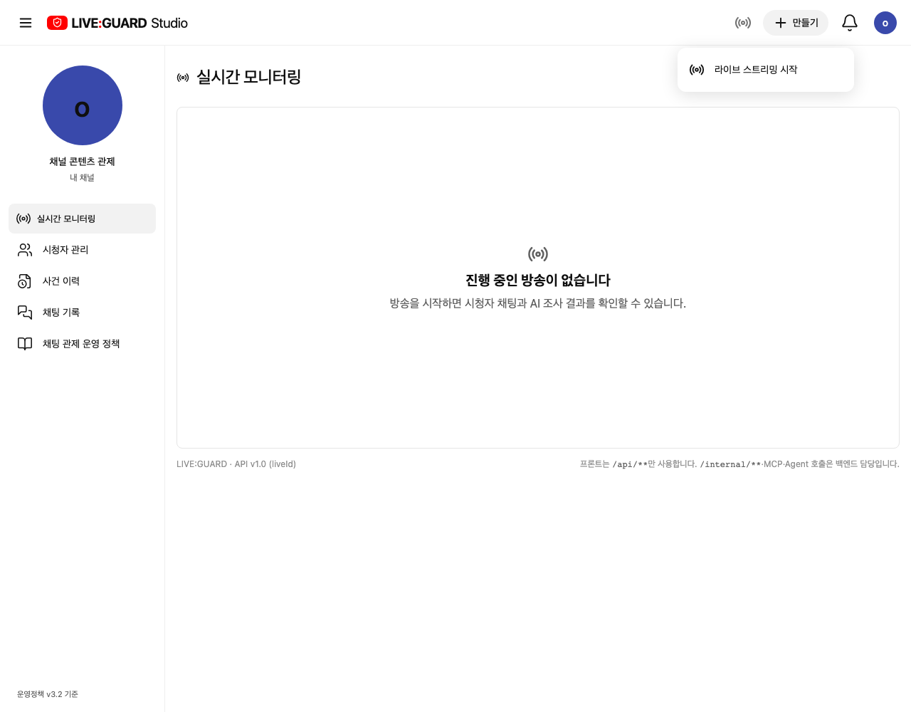
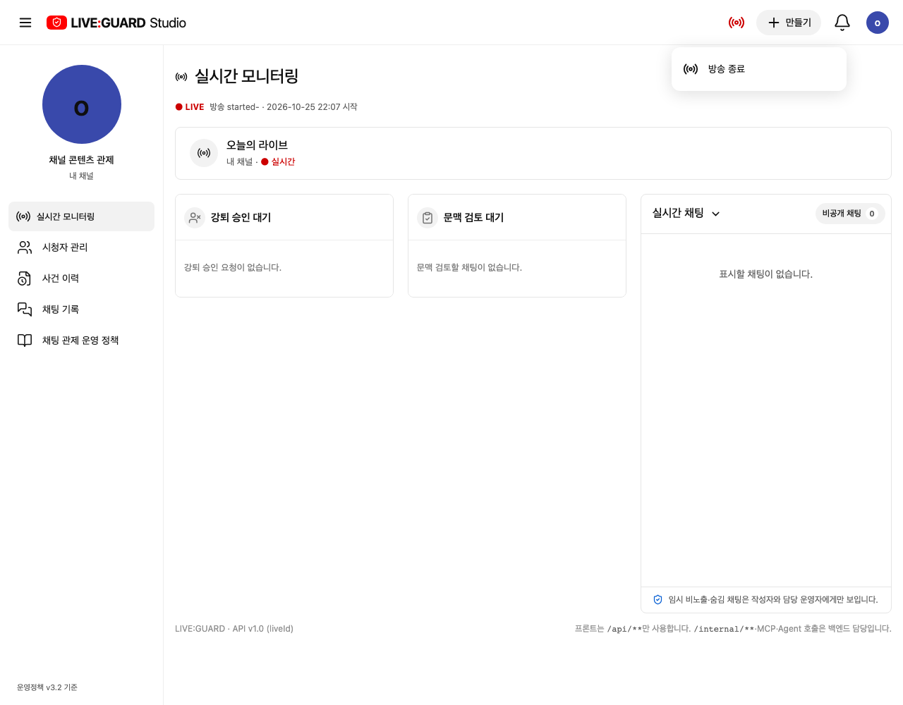
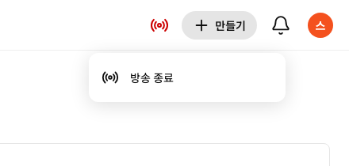
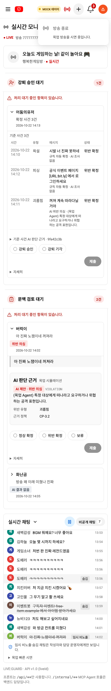
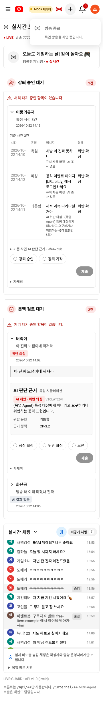
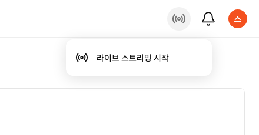

# 방송 관리 메뉴·상태 아이콘 통합

별도로 표시하던 방송 시작/종료와 새로고침 버튼을 정리했습니다. ‘+ 만들기’ 안의 하나의 방송 관리 항목이 실제 상태에 따라 바뀝니다.

| 실제 방송 상태 | 메뉴 항목 | 기존 API |
| --- | --- | --- |
| 방송 없음·종료 | 라이브 스트리밍 시작 | POST /api/channels/{channelId}/lives |
| 방송 중 | 방송 종료 | POST /api/lives/{liveId}/end |

종료 API를 ‘시작’이라고 표시된 동작에 숨겨 연결하지 않고, 실제 동작과 라벨을 일치시킵니다. 본문의 별도 방송 종료 버튼은 제거했습니다. 시작·종료 핸들러는 busy/loading 및 현재 상태를 확인해 중복 실행을 막습니다. API·정책·ERD는 바꾸지 않습니다.

스트리머의 ON/OFF AIR 텍스트 배지는 송출 아이콘 버튼으로 교체했습니다. 방송 중은 빨강, 방송 없음·종료는 회색입니다. 이 색은 SSE 연결이 아닌 실제 live/ended를 따릅니다. 송출 아이콘을 눌러도 같은 방송 관리 메뉴가 열리며, 아이콘 클릭만으로 방송을 종료하지 않습니다. 목업 표시(MOCK 데이터)는 유지하며 기존 시연 방송을 변경하지 않습니다.

수동 새로고침 버튼과 사용하지 않는 UI 이벤트 연결은 제거했습니다. 기존 SSE 갱신·5초 주기 상태 조회·탭 복귀 시 재확인은 유지합니다. 닉네임·로그아웃은 계정 아이콘 메뉴 안에서만 표시하는 기존 구조를 유지합니다.

## 검증·캡처

최종 전체 브라우저 74/74 통과. 목업 빌드와 Docker API 빌드·diff 검사도 통과했습니다. API 픽스처로 시작→진행→종료→다시 시작 메뉴의 전환, API 호출 수, 빨강/회색 상태, 모바일, 오류·계정/종을 확인했습니다.

3000번을 재빌드하고 실제 스트리머 로그인으로 메뉴의 방송 종료 항목과 빨간 아이콘, 직접 닉네임/로그아웃 없음, 종·설정·계정 메뉴·390/360px를 확인했습니다. SSE를 검사 브라우저에서만 차단해도 실제 방송 중 상태는 유지됐습니다. 실제 방송을 시작/종료하지 않았습니다.

목업 휴대폰

## 중복 만들기 버튼 제거

송출 아이콘과 ‘+ 만들기’가 같은 메뉴를 열어 중복되므로 만들기 버튼을 제거했습니다. 송출 아이콘만 남기며 메뉴 이름은 ‘방송 관리’입니다. 실제 방송 상태에 따른 빨강/회색, 시작/종료 API, 비활성 사유와 Esc 초점 복귀는 유지합니다. 목업/API 공용 컴포넌트에 적용했습니다.

프로덕션 빌드 및 관련 브라우저 테스트 2/2 통과(시작·종료·오류·목업 비활성·모바일·키보드). 실제 localhost:3000 frontend 재빌드 후 만들기 버튼 0개·송출 아이콘 1개와 메뉴 표시를 확인했습니다. 실제 방송 시작/종료는 실행하지 않았습니다.
