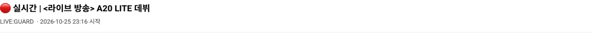
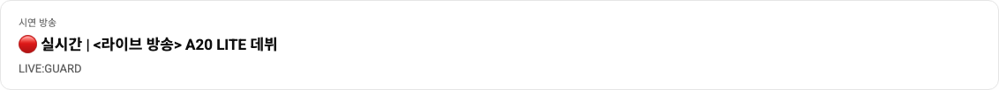

# 방송 표시명 통일과 요약 간소화

방송 표시명은 공용 broadcastPresentation의 `LIVE:GUARD`, 제목은 `🔴 실시간 | <라이브 방송> A20 LITE 데뷔`를 사용합니다. 시청자·스트리머·관리자에 같은 값을 표시하며 관리자 목업의 실시간 집계/기간 통계/추적 채널명도 통일했습니다. 다른 채널의 고정 예시 데이터는 유지합니다. 로그인한 사용자의 계정 닉네임이나 API/ERD는 변경하지 않습니다. 관리자 API 미지원 수치는 기존 미연동 상태를 유지하며 지정한 방송명은 시연 방송 표시 정보입니다.

스트리머의 큰 방송 카드와 위쪽 LIVE 상태 줄을 하나의 작은 요약으로 합쳤습니다. 방송 ID·중복 LIVE/실시간 표시·큰 송출 아이콘·카드 외곽선을 제거하고 제목, 스트리머명, 시작 시간만 남겼습니다. 종료 시에는 종료/결정 불가 안내를 같은 요약 안에 표시합니다.

검증: 프로덕션 빌드, 관리자 목업/API 표시·모바일 필터·관제 반응형·방송 시작/종료 관련 브라우저 테스트 5/5 통과. Docker frontend 재빌드 후 localhost:3000의 세 역할에서 제목과 스트리머명 표시 확인. 전체 회귀 테스트는 이번 변경 후 실행하지 않았습니다.
