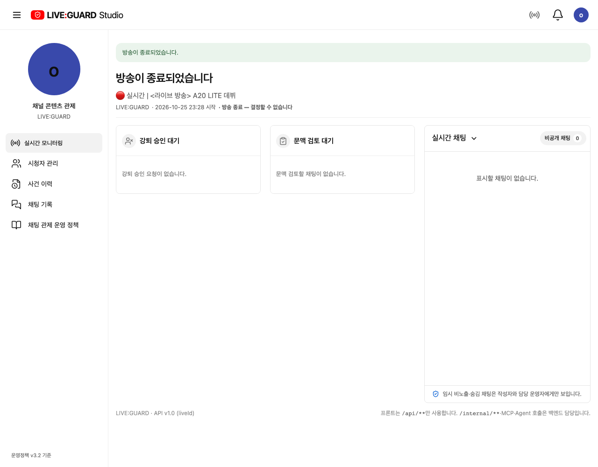
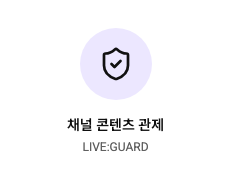

# 방송 표시명 통일과 요약 간소화

방송 표시명은 공용 broadcastPresentation의 `LIVE:GUARD`, 제목은 `🔴 실시간 | <라이브 방송> A20 LITE 데뷔`를 사용합니다. 시청자·스트리머·관리자에 같은 값을 표시하며 관리자 목업의 실시간 집계/기간 통계/추적 채널명도 통일했습니다. 다른 채널의 고정 예시 데이터는 유지합니다. 로그인한 사용자의 계정 닉네임이나 API/ERD는 변경하지 않습니다. 관리자 API 미지원 수치는 기존 미연동 상태를 유지하며 지정한 방송명은 시연 방송 표시 정보입니다.

스트리머의 큰 방송 카드와 위쪽 LIVE 상태 줄을 하나의 작은 요약으로 합쳤습니다. 방송 ID·중복 LIVE/실시간 표시·큰 송출 아이콘·카드 외곽선을 제거하고 제목, 스트리머명, 시작 시간만 남겼습니다. 종료 시에는 종료/결정 불가 안내를 같은 요약 안에 표시합니다.

검증: 프로덕션 빌드, 관리자 목업/API 표시·모바일 필터·관제 반응형·방송 시작/종료 관련 브라우저 테스트 5/5 통과. Docker frontend 재빌드 후 localhost:3000의 세 역할에서 제목과 스트리머명 표시 확인. 전체 회귀 테스트는 이번 변경 후 실행하지 않았습니다.

## 상태에 따른 최상단 제목

실시간 모니터링 본문에서 별도 ‘실시간 모니터링’ 제목을 제거하고 방송명을 최상단 h1으로 올렸습니다. 종료 후 같은 위치에는 **방송이 종료되었습니다**를 표시하고 방송명은 보조 정보로 남깁니다. 시작 시간·스트리머명 및 종료 시 결정 불가 안내는 유지합니다. 다른 메뉴의 제목과 방송 미시작 안내는 유지합니다.

관련 관제/상태 전환 테스트 3개 통과. 방송 중 제목 heading과 중복 status-strip 없음, 종료 멘트 전환을 추가 확인했습니다. 목업/API 공통 적용, 프로덕션 빌드와 실제 localhost:3000 재빌드·방송명 표시 확인 완료. 실제 방송을 종료해 시험하지 않고 종료 상태는 격리 API로 검증했습니다.

## 채널 아바타 통일

이름 변경 후 남아 있던 주황색 ‘스’ 아바타를 제거했습니다. 스트리머의 사이드바 채널 아바타와 우상단 계정 아이콘/메뉴 아바타를 연보라 배경의 LIVE:GUARD 방패로 통일했습니다. 접힌 메뉴에서는 작은 방패로 표시합니다. 계정 메뉴의 실제 로그인 닉네임과 시청자·관리자 아바타는 유지합니다.

프로덕션 빌드 및 계정·아이콘 탐색 관련 테스트 3/3 통과. Docker frontend 재빌드 후 실제 localhost:3000에서 사이드바와 계정 방패 표시를 확인했습니다.

참조 아이콘에 맞춰 펼친 사이드바의 원형 채널 아바타를 72px, 내부 방패를 36px로 줄였습니다. 접힌 메뉴는 32px/22px를 유지합니다. 프로덕션 빌드와 실제 localhost:3000 표시를 확인했습니다.
