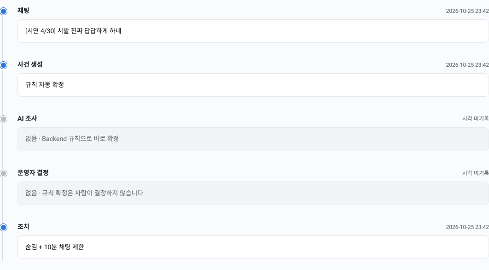
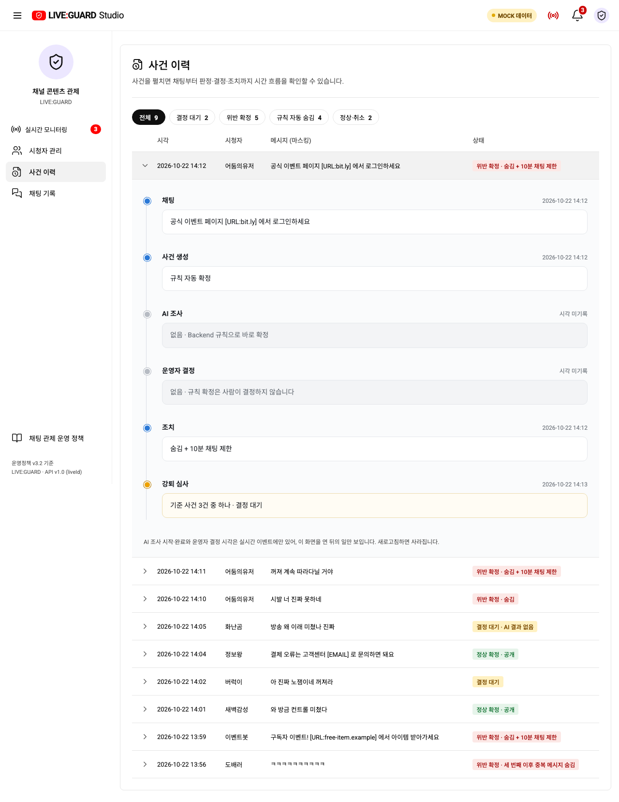
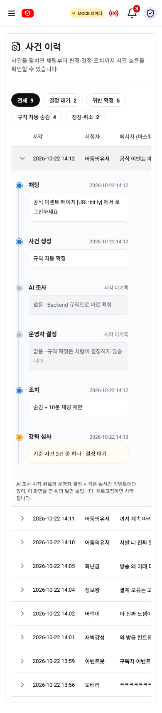
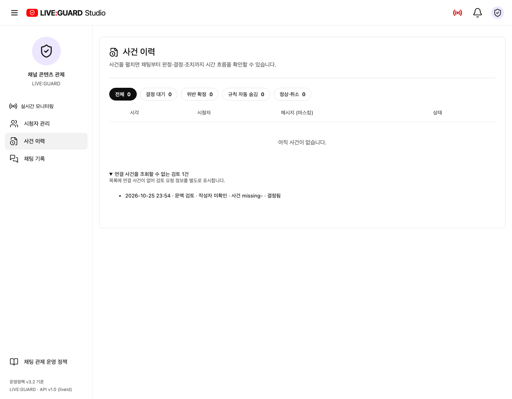

# 사건 이력의 세로 처리 흐름

기존 사건 상세는 단계·시각·설명이 가로 행으로 나열되어 처리 순서를 읽기 어려웠고, 본문 제목 ‘사건 이력’도 두 번 표시됐습니다. 참고한 분석 흐름처럼 점과 세로선으로 단계를 연결하고 단계별 시각과 설명 카드를 분리했습니다. 라이트 모드의 기존 색·서체를 유지하며 진행은 파랑, 대기는 노랑, 생략은 회색과 문구로 구분합니다.

## 정보 구성

- 사건 목록과 상태 필터는 유지하며 행의 펼치기 버튼으로 상세 흐름을 엽니다.
- 상세는 채팅 → 사건 생성 → AI 조사·판정 → 문맥 검토 요청 → 운영자 결정 → 조치 → 해당하는 경우 강퇴 심사로 이어집니다. 규칙 자동 확정 사건은 AI/운영자 단계를 생략했다고 명시합니다.
- 실제 기록된 시각만 표시합니다. 없는 시각은 ‘시각 미기록’이며, 실행되지 않은 단계는 생략 문구로 구분합니다. 실시간 이벤트 시각의 새로고침 시 유실 한계도 유지합니다. AI 내부 사고 과정을 생성하거나 판정을 바꾸지 않습니다.
- 본문 제목은 한 번만 표시합니다. 별도 ‘사건/검토 기록’ 탭은 제거하고 검토 요청 시각·상태를 사건 흐름에 합쳤습니다. 강퇴 심사 상태와 실행 상태도 유지합니다.
- 연결 사건을 조회할 수 없는 검토는 ‘연결 사건을 조회할 수 없는 검토’ 접힘 목록으로 보존합니다. 데이터가 없다고 요청을 버리지 않습니다.
- 목업/API는 공통 StudioScreen을 사용하며 API·권한·ERD·운영 정책 변경은 없습니다.

## 화면

실제 localhost:3000: 규칙 자동 확정 사건 상세

목업 데스크톱/390px

격리 API: 사건을 조회할 수 없는 검토도 보존

## 검증

프로덕션 빌드 및 관련 브라우저 테스트 6/6 통과: 기존 API AI 조사/판정/근거·결정 표시, 검토 카드/채팅 기록에서 해당 사건으로 이동, 알림 연결, 단일 제목·세로 단계·390px 가로 넘침 없음, 연결 사건 없는 검토 보존. 최종 모바일 폭 보정 후 사건 이력 테스트 2/2 재확인. Docker frontend 재빌드 후 실제 localhost:3000에서 제목 1개·검토 탭 0개·실제 사건 타임라인 표시를 확인했습니다. 전체 회귀 테스트는 이번 변경 후 실행하지 않았습니다.
