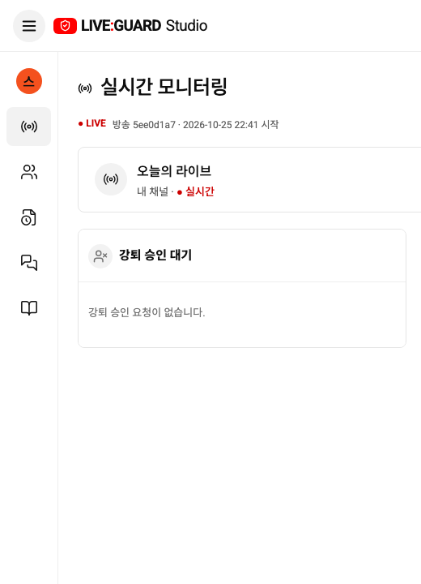
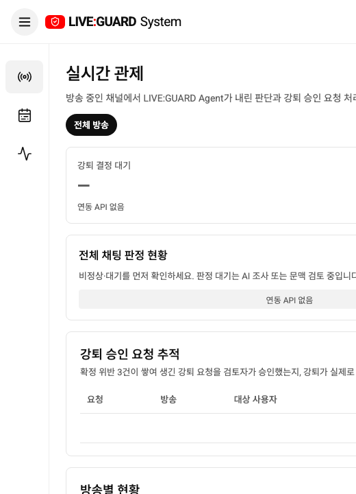

# 접힌 메뉴의 아이콘 탐색

YouTube Studio 참고 화면처럼 데스크톱 메뉴를 접어도 아이콘만 남도록 변경했습니다. 스트리머·관리자 모두 펼친 메뉴에서 ☰를 누르면 폭 72px 아이콘 메뉴로 바뀌며 본문 영역이 넓어집니다. 다시 누르면 라벨이 표시됩니다. 선택 상태와 기존 페이지/필터는 유지합니다.

아이콘은 그대로 클릭하거나 키보드로 탐색할 수 있습니다. 메뉴별 접근성 이름과 title 툴팁을 제공하고, 숨긴 라벨 때문에 이름이 사라지지 않도록 했습니다. 스트리머의 큰 채널 아바타는 작은 아바타로 줄이고 채널 설명·하단 문구·건수 배지는 접힌 상태에서 숨깁니다. 1100px 미만에서는 기존 서랍 방식을 유지하여 본문 폭을 확보합니다.

공용 StudioScreen/SystemPage에 반영되어 목업/API가 같은 동작을 사용합니다. API·인증·정책 변경은 없습니다.

## 실제 localhost:3000

스트리머:

관리자:

## 검증

프로덕션 빌드 및 관련 브라우저 테스트 5개 통과(관리자 목업/API 서랍·모바일, 관제 반응형, 스트리머 목업/API 아이콘으로 페이지 이동·선택 유지·다시 펼치기). Docker frontend를 재빌드하고 실제 localhost:3000 두 역할에서 너비 72px·접근성 트리 노출·화면을 확인했습니다. 전체 회귀 테스트는 이번 변경 후 실행하지 않았습니다.
