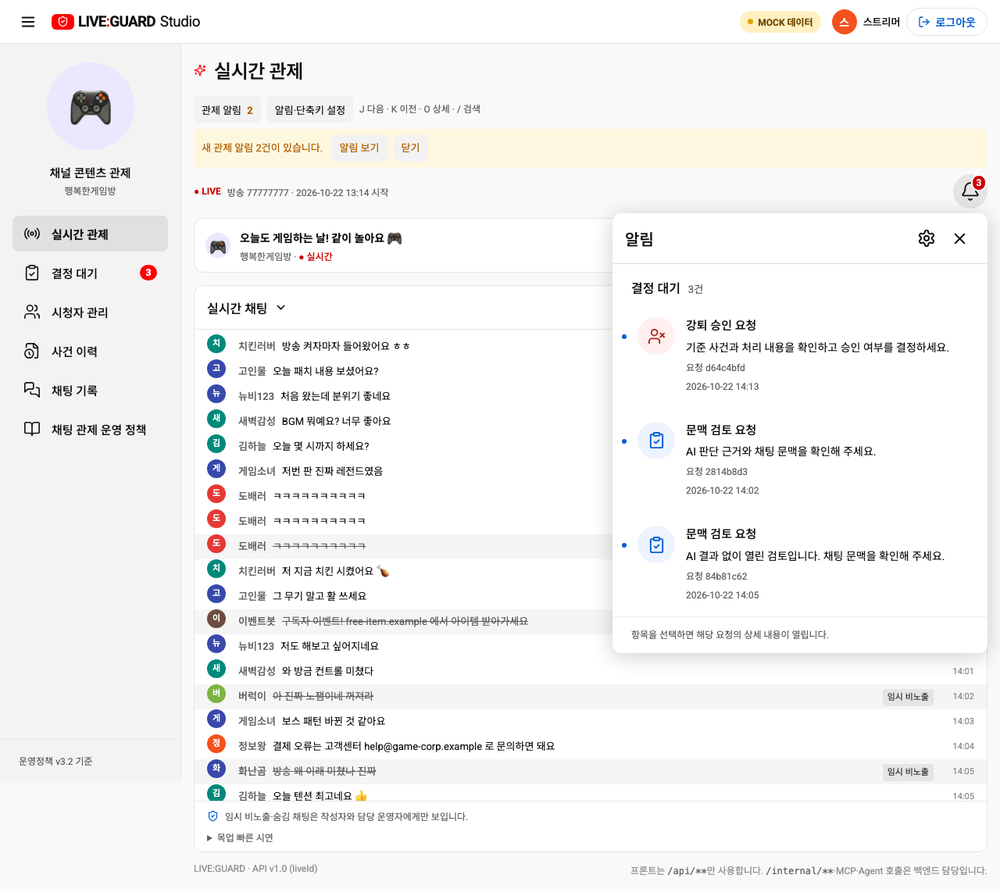
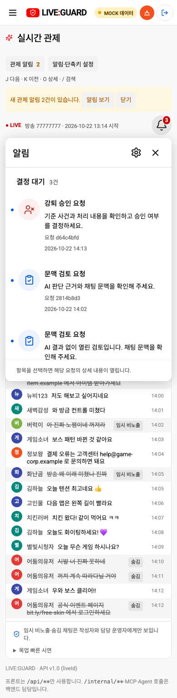
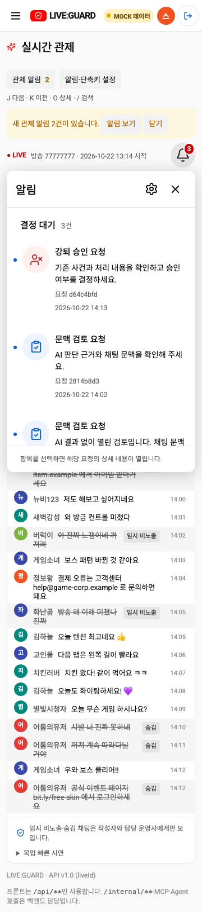
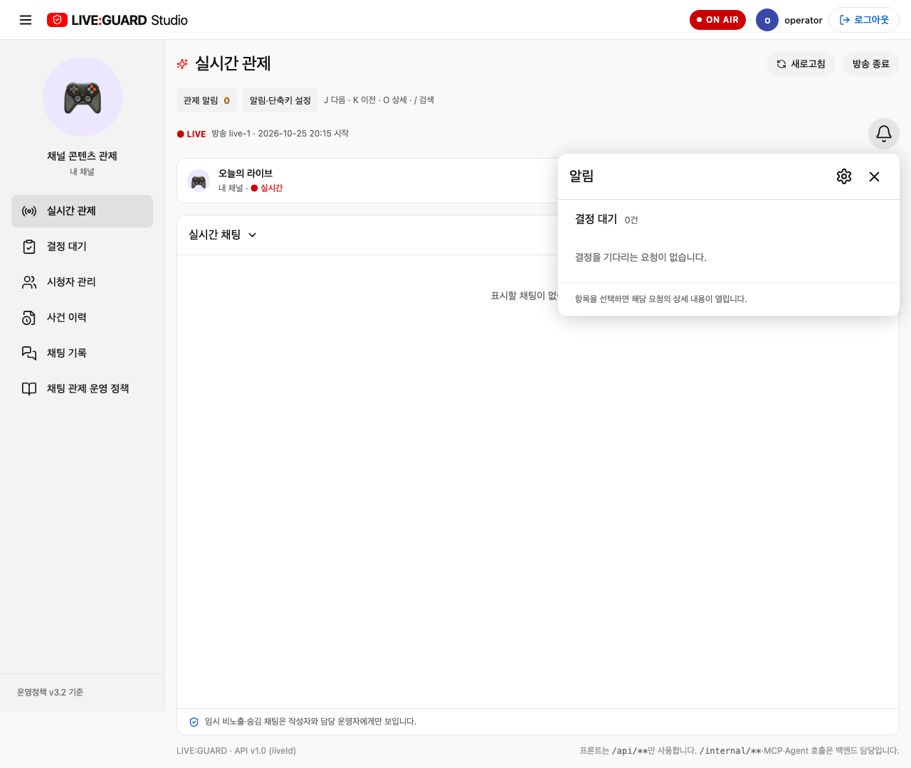

# 스트리머 결정 대기 종 알림

기존 방송 상태 줄의 노란 ‘결정 대기 N건 →’ 버튼은 바로 검토 페이지로 이동해 어떤 요청인지 먼저 확인하기 어려웠습니다. 사용자 제공 YouTube 알림 화면을 참고해 방송 상태 줄 오른쪽에 종 아이콘을 두고, 클릭하면 상세 목록을 먼저 보여 주도록 바꿨습니다.

| 항목 | 적용 동작 |
| --- | --- |
| 종·배지 | 검은 윤곽 종, 선택·호버 시 회색 원, 빨간 대기 건수 배지. 10건 이상은 9+, 0건은 배지 없음 |
| 상세 패널 | 흰 배경·둥근 모서리·그림자, 알림 제목과 설정·닫기 버튼, 파란 점과 원형 요청 아이콘 |
| 목록 내용 | 강퇴 승인/문맥 검토, 확인할 내용, 짧은 요청 ID, 한국 시간 접수 시각. 채팅 원문·개인정보는 목록에 복제하지 않음 |
| 이동 | 선택한 요청의 종류 탭과 검토 카드를 열고 카드 제목으로 키보드 초점 이동. 결정은 기존 상세 화면에서 수행 |
| 설정 | 톱니바퀴를 누르면 기존 알림·단축키 설정을 열고 첫 입력으로 초점 이동 |
| 닫기 | 종 재클릭, 닫기 버튼, 바깥 클릭, Escape. Escape·닫기 버튼은 종으로 초점 복귀 |
| 갱신 | 현재 방송 PENDING 검토만 집계. 결정·무효·이전 방송 요청 제외. 서버 갱신 시 건수와 목록 동시 반영 |
| 빈 상태·종료 | 대기 0건 안내. 방송 변경·종료 시 열린 패널 닫기, 종료 후에는 종료 안내 |
| 휴대폰 | 360·390px에서 화면 안에 패널 표시. 긴 목록은 패널 내부 스크롤. 360px에서 기존 헤더가 넘치던 문제는 로고·간격을 줄여 보완 |

파란 점은 결정이 필요한 항목의 표시이며 읽음 기록을 저장하는 기능은 아닙니다. 기존 관제 알림 도구의 신규/장기 대기/실행 실패 설정과 이 대기 목록은 구분됩니다. 종의 배지는 현재 미결정 요청 수이므로 알림 설정을 꺼도 요청 수를 표시합니다. API·정책·DB 변경 없이 기존 검토 데이터와 이동 함수를 사용합니다.

새 브라우저 테스트는 상세 이동·초점, 설정 열기, Escape·바깥 클릭, 360·390px 너비, 9+ 배지, SSE로 결정된 요청 제거, 이전 방송·무효 요청 제외, 빈 상태·방송 종료를 검증합니다. 최종 검증: 브라우저 68/68, 계약 4/4, 운영 도구 3/3으로 총 75개 통과. 목업·API 빌드와 `git diff --check` 통과.

캡처는 목업이며 빈 상태 캡처는 격리된 API 테스트 픽스처입니다.

휴대폰 390px

휴대폰 360px

