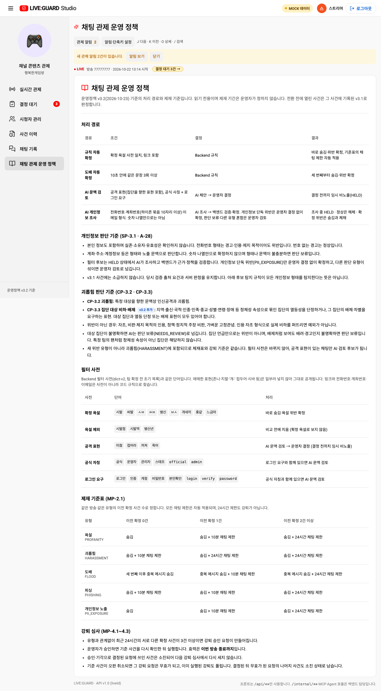
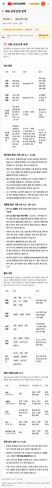
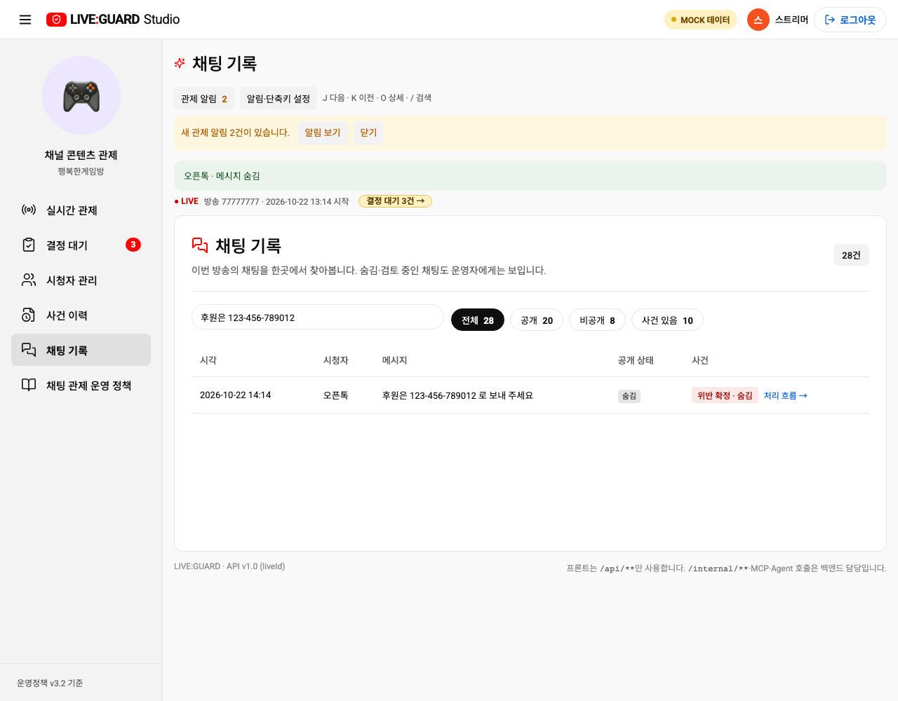

# 운영정책 v3.2 대조 및 프론트 반영

2026-10-25 저장소 원문을 대조했습니다. 정책 개정일은 2026-10-23이며, v3.2 안에서 보완된 개인정보 형태 기반 금지(A-28)까지 포함합니다. 화면에 버전명이 v3.2라고 적혀 있어도 설명과 목업의 판단 기준은 이전 기준이 남아 있었습니다.

## 확인한 원본

- [BE POLICY](https://github.com/skalaP05-03-261019/liveguard-be/blob/1b1df68f9661f6fc4d17bacd6295c91724dc03c9/docs/policy/POLICY.md): 위반 정의, 확정 주체, 기존 제재표.
- [BE TBD-decisions A-27·A-28](https://github.com/skalaP05-03-261019/liveguard-be/blob/1b1df68f9661f6fc4d17bacd6295c91724dc03c9/docs/policy/TBD-decisions.md): 버전 전환·소급 금지, 개인정보 단독 확정 제한, 기존 계약 유지.
- [Agent 정책 원문](https://github.com/skalaP05-03-261019/liveguard-agent/blob/3e937f51568680c23fc8c1435045d46cd01ff951/app/rag_mcp/policies/policy-v3.2.md): SP-3.1, CP-2.2, CP-3.3.
- [Agent 조사 프롬프트](https://github.com/skalaP05-03-261019/liveguard-agent/blob/3e937f51568680c23fc8c1435045d46cd01ff951/prompts/investigator-v3.2.md): UNKNOWN 자체만으로 보류하지 않는 기준, 운영자 판단 유형이 섞인 경우 검토 필요.

## 무엇이 왜 달라졌나

| 항목 | 발견한 기존 동작·설명 | v3.2 기준과 반영 |
| --- | --- | --- |
| 개인정보 실존 확인 | 실제 개인정보라는 근거가 없으면 모든 후보를 보류 | 실존·소유자·유효성을 요구하지 않음. 전화번호 형태 또는 다른 개인정보의 형태+노출 문맥을 판단 |
| 본인 번호·경고·인용 | `고객센터` 등의 단어가 있으면 정상 처리할 수 있었음 | 전화번호에는 CP-2.2 예외 없음. 전화번호 확인을 회사 이메일 합성 예시 예외보다 먼저 수행 |
| 개인정보 단독 위반 | 목업에 위반 자동 확정 분기가 없어 모두 운영자 검토 | AI 제안→BE 검증을 목업으로 재현한 뒤 PII_EXPOSURE만 확정·숨김. 첫 위반은 기존 표에 따라 추가 TIMEOUT 없음 |
| 혼합 유형·근거 부족 | 소유자 확인 여부를 보류 근거로 사용 | 공격·사칭 후보 혼합 또는 형태·노출 문맥 부족을 보류 근거로 사용. 자동으로 다른 유형을 함께 확정하지 않음 |
| 집단 대상 비하·배제 | 정체성 집단 언급만으로 CP-3.3 위반을 제안 | 집단과 배제·열등 단정이 함께 필요. 배려·경고·인용 여부가 불명확하면 보류. 문맥 경로는 AI가 위반을 제안해도 HELD+운영자 결정 유지 |
| 정책 페이지 | ‘정책 근거’, 개인정보 최신 기준 누락 | 사용자 요청대로 ‘채팅 관제 운영 정책’. SP-3.1·A-28과 버전별 기준, CP-3.3의 모호한 문맥 설명 추가 |
| 처리 흐름 | ‘실제 개인정보 근거가 검증될 때만 확정’ | v3.2 형태·문맥 판단과 BE 검증을 구분하고 v3.1 사건은 당시 기준 유지라고 안내 |
| 작성자 안내 | 개인정보 자동 확정도 운영자가 결정한 것처럼 표현 가능 | 개인정보 숨김은 확정 사실만 안내. 운영자 결정 여부를 만들어내지 않음 |

## API·ERD와의 경계

`src/api/client.ts`, 계약 타입, 엔드포인트, 요청·응답 필드, DB 스키마를 변경하지 않았습니다. API 모드에서 프론트가 원문을 재판정하거나 서버 결과를 덮어쓰지 않습니다. 실제 사건의 정책 버전 선택·근거 검증·v3.1 출처 요건·알 수 없는 버전의 보수적 처리는 서버 책임입니다. API에 제공되지 않는 사건별 정책 버전을 추정해 표시하지 않습니다.

목업은 현재 v3.2의 한정된 합성 예시를 결정적으로 재현합니다. 정규식이 실제 AI 조사와 동일한 품질을 제공한다는 뜻은 아닙니다. 기존 후보 탐지(전화번호·하이픈 계좌·이메일), 경로 우선순위, 숫자 나열 제외, 마스킹, 제재표와 강퇴 승인 요건은 유지합니다. 정책에 주소·계정정보가 포함되어도 모든 형태를 현재 필터가 탐지한다는 의미는 아닙니다. AI 미응답(A-25)은 개인정보에서도 HELD+운영자 검토를 유지합니다.

v3.1 사건은 소급 변경하지 않습니다. BE·Agent 원문 일치를 확인한 것으로, 배포된 이미지·설정의 정책 버전 전환과 RAG 재색인 완료를 확인한 것은 아닙니다. 배포 시 BE와 Agent의 동시 전환을 별도로 확인해야 합니다.

## 검증과 캡처

최종 코드 기준 `npm run test:chat` 66개, `npm run test:contracts` 4개, `npm run test:tools` 3개로 총 73개가 통과했습니다. 목업·API(`VITE_USE_API=true`) 빌드와 `git diff --check`도 통과했습니다. 모바일 검사는 크기 변경 후 레이아웃 반영을 기다립니다. 새 회귀 테스트는 본인·가짜·경고·대표번호, 계좌·이메일 노출, 합성 회사 이메일 정상, 문맥 불충분, 공격 표현 혼합, 숫자만 있는 경우, CP-3.3 명확/모호 사례, AI 미응답을 확인합니다. 캡처는 목업 데이터입니다.

기존 미완료 작업인 #30(방송 생명주기·목업 지연 등)을 이 변경만으로 닫지 않습니다. 제재·DB·외부 플랫폼 연동을 확대하지 않습니다.

390px 휴대폰

