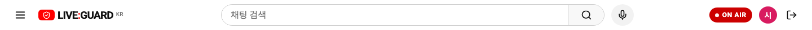
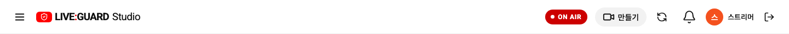
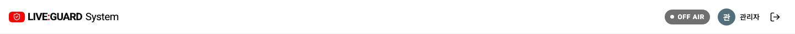
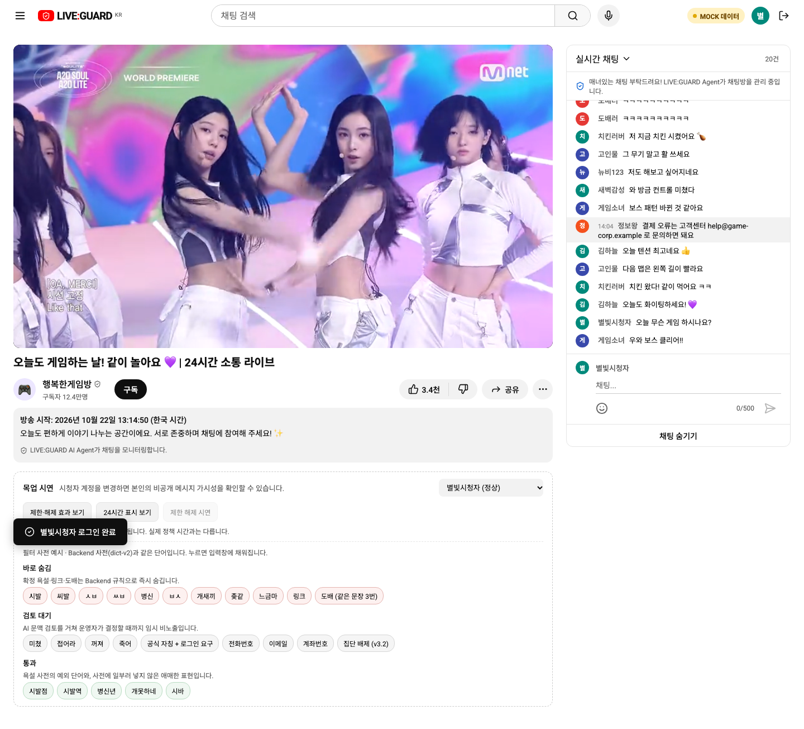
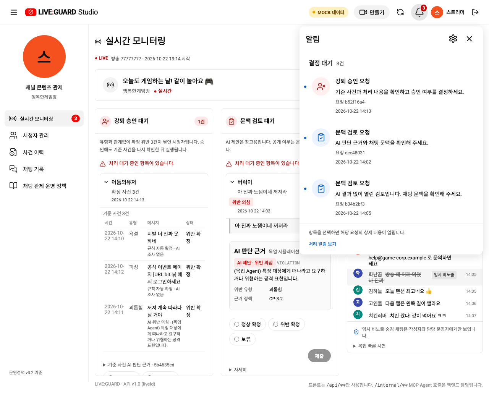
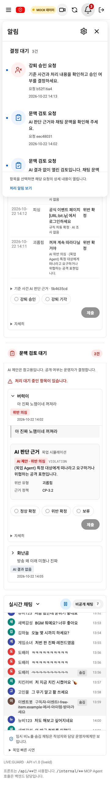

# 관리용 헤더 버튼을 스트리머로 이동

사용자 캡처의 영상·종·새로고침은 방송 관리에 맞춰 스트리머 헤더에 모았습니다. 시청자의 영상/알림 장식 버튼과 수동 새로고침을 제거했습니다. 시청자에게 표시하던 합성 9+ 알림도 함께 제거했습니다.

| 역할 | 영상/만들기 | 종 알림 | 헤더 새로고침 |
| --- | --- | --- | --- |
| 시청자 | 없음 | 없음 | 없음 |
| 스트리머 | 기존 만들기 메뉴의 아이콘을 영상으로 변경, 라이브 시작 연결 유지 | 기존 실데이터 종 하나 유지 | 기존 실제 API 갱신을 헤더 아이콘으로 이동 |
| 시스템 운영자 | 기존 역할별 화면 유지 | 기존 역할별 화면 유지 | 기존 역할별 화면 유지 |

카메라 모양의 별도 장식 버튼을 더하지 않고 기존 만들기를 재사용합니다. 종도 복제하지 않습니다. 스트리머 본문의 중복 새로고침은 제거했고, 종은 프로필·이름 왼쪽에 유지합니다. 480px 이하에서는 로고 심볼을 사용해 늘어난 관리 아이콘이 가로로 넘치지 않게 합니다.

시청자의 자동 갱신·탭 복귀 시 상태 확인은 유지합니다. 관련 회귀 테스트는 삭제한 버튼을 호출하지 않고 실제 브라우저 focus 이벤트를 사용해 동일한 상태 재조회와 종료/강퇴 보호를 검증합니다. 새로고침이 방송을 재개하거나 강퇴를 무시하는 기능은 아닙니다.

API 모드의 스트리머 새로고침은 기존 load 경로를 사용하며, 요청 중에는 비활성입니다. 목업은 현재 반응형 데이터를 유지한 채 최신 상태 확인 안내를 표시하고, 새로고침으로 시연 데이터·결정 선택을 초기화하지 않습니다. API·역할 권한·정책·ERD 변경은 없습니다.

## 실제 API 확인

3000번 프론트엔드 재빌드 후 실제 세 역할로 로그인했습니다. 시청자는 만들기/종/새로고침이 0개, 스트리머는 각 1개이며 공통 로그아웃은 유지됐습니다. 실제 스트리머의 종·설정·시작 메뉴와 390/360px 가로 넘침 없음도 확인했습니다. 방송·업무 데이터는 변경하지 않았습니다.

시청자:

스트리머:

시스템 운영자:

목업 전체 화면

집중 검사에서 시청자 장식 제거·브라우저 복귀 시 재조회·방송 종료와 강퇴의 늦은 응답 보호·스트리머 종·모바일을 확인했습니다. 최종 전체 브라우저 회귀 73/73, 목업 빌드·Docker API 빌드·diff 검사가 통과했습니다.
