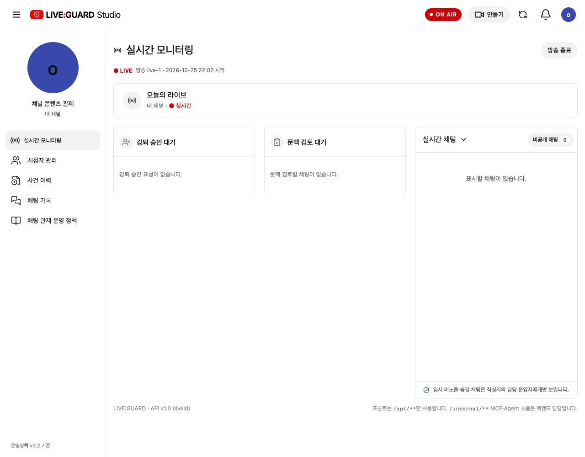
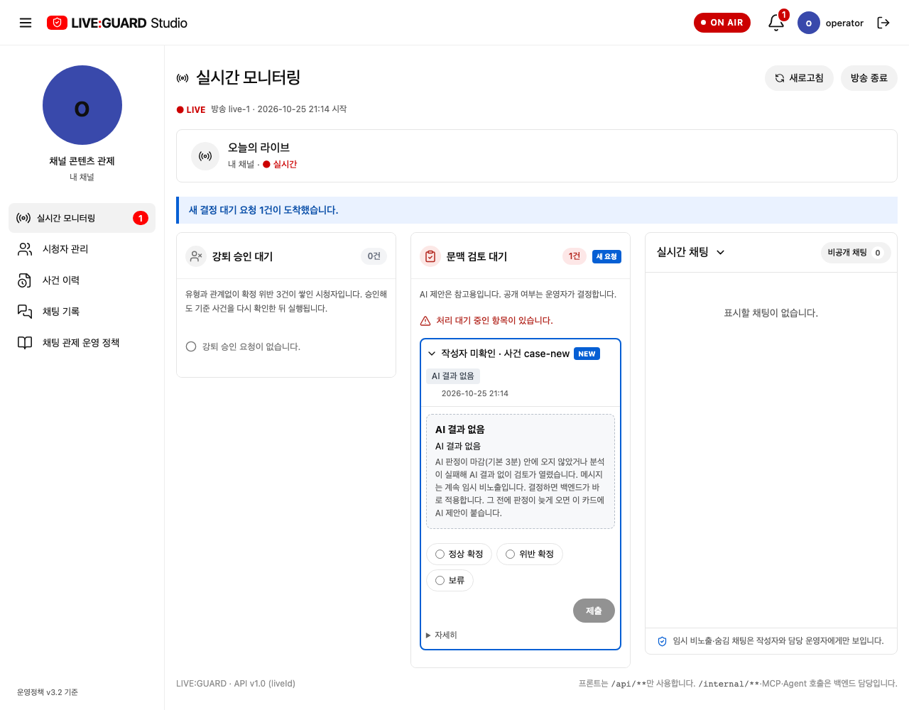
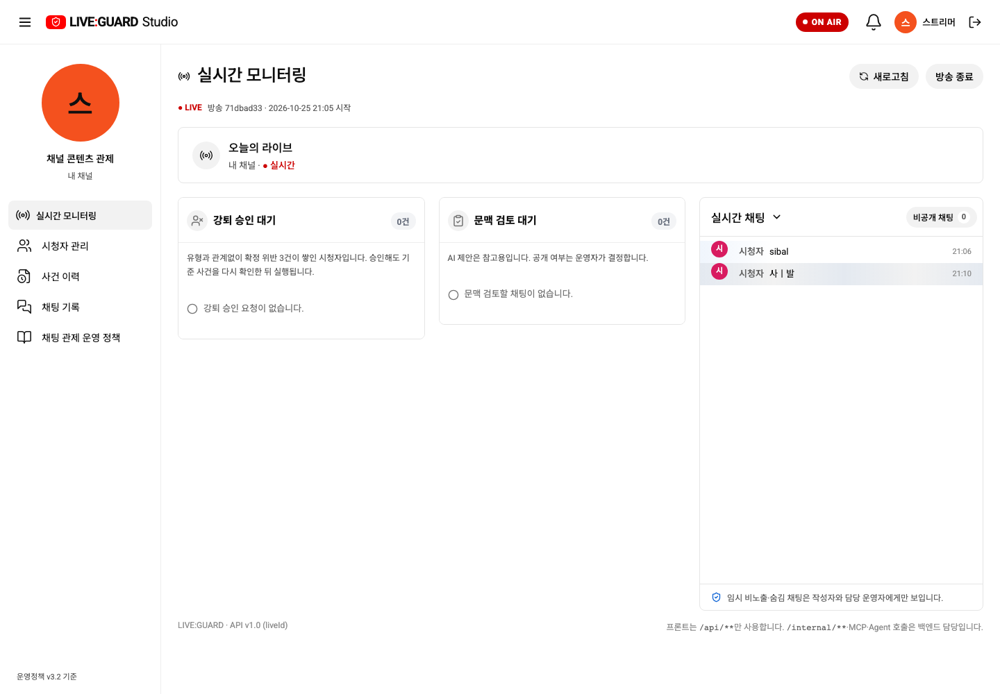
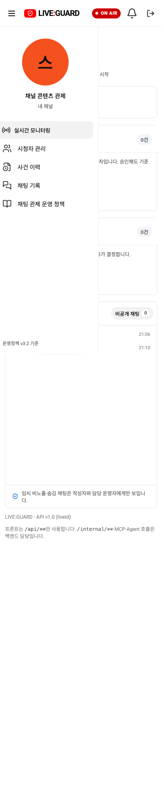

# 상태 요약 위젯: 빈 상태와 처리 필요 상태 구분

사용자가 제시한 디자인대로 강퇴 승인 대기·문맥 검토 대기를 공통 `StatusSummaryWidget.vue`로 분리했습니다. 이전에는 건수 배지가 항상 회색이어서 실제 처리할 요청이 있는지 구분이 약했습니다. 이제 빈 상태는 차분하게, 요청이 있을 때만 경고색으로 강조합니다.

| 상태 | 표시 |
| --- | --- |
| 0건 | 회색 아이콘과 차분한 유형별 빈 안내. 0건 배지는 표시하지 않음. 경고 안내 없음 |
| 1건 이상 | 빨간 아이콘·연한 빨강 배지·진한 빨강 건수, 경고 아이콘과 ‘처리 대기 중인 항목이 있습니다’ 안내 |
| 방송 종료 | 기존 결정 차단을 유지하고 ‘방송이 종료되어 결정할 수 없습니다’ 안내 |

제목은 15px/600, 상태 안내는 13px로 구분합니다. 사용자 후속 요청에 따라 두 설명 문구와 빈 안내 왼쪽 원형 아이콘을 제거했습니다. 제목/아이콘과 건수 배지를 한 줄에 배치하고 건수는 우측에 정렬합니다. 색만으로 구분하지 않도록 건수·아이콘·문구를 함께 표시합니다. 요청 종류별 독립 건수, 3열 순서, 기존 결정 카드·새 요청 강조·키보드/종 이동을 유지합니다.

위젯은 title/kind/count/emptyText/fresh/ended를 받고, 기존 결정 카드들은 기본 슬롯으로 표시합니다. 실제 집계·필터·결정 요청은 상위 화면과 기존 API 로직을 유지합니다. API·정책·ERD 변경은 없습니다. 목업과 API가 같은 StudioScreen/위젯을 사용합니다.

## 증거

첫 두 장은 격리 API 테스트 픽스처입니다. 실제 방송에 검토 데이터를 생성하지 않았습니다.

3000번 프론트엔드만 재빌드하고 실제 스트리머 로그인으로 빈 상태·종·설정·390/360px 가로 넘침 없음·런타임 오류 없음을 확인했습니다. 현재 실제 방송의 검토는 0건입니다.

실제 API 휴대폰

## 검증

집중 브라우저 검사 6개에서 초기 중립 상태, SSE 신규 요청의 경고 전환, 다른 종류의 0건 중립 유지, 종료 후 결정 차단과 기존 이동·선택·효과·모바일 배치를 확인했습니다. 최종 전체 브라우저 회귀 71/71, 목업 빌드, Docker API 빌드, `git diff --check`가 모두 통과했습니다.

설명·원형 아이콘 제거 후 관련 기존 브라우저 테스트 3개·빌드와 3000번 Docker 재빌드/실제 API 확인을 마쳤습니다. 카드 제목의 종류 아이콘과 요청이 있을 때의 경고 아이콘은 유지했습니다.

후속 요청으로 0건 배지를 숨겼습니다. 요청이 1건 이상일 때만 경고색 건수 배지를 표시합니다. 관련 기존 테스트 2개·빌드 및 3000번 재빌드/실제 API 확인을 마쳤습니다.
