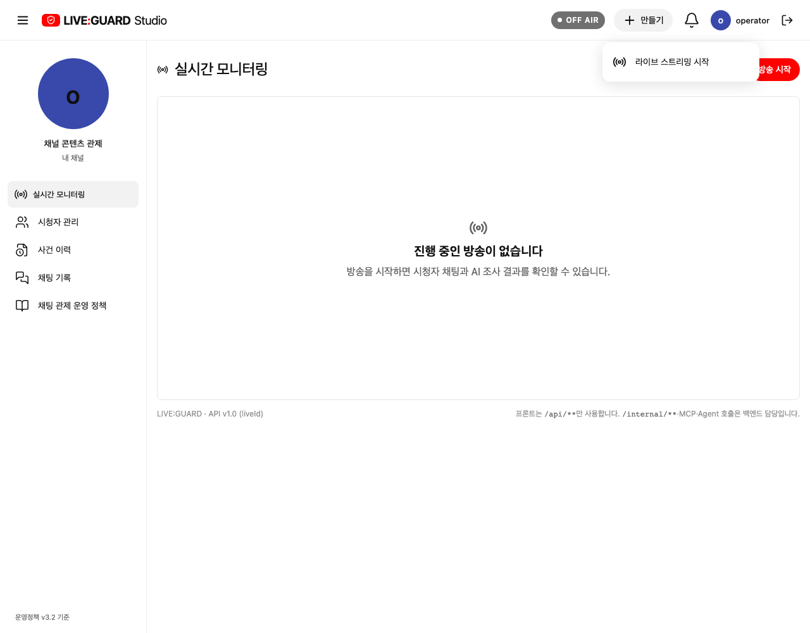
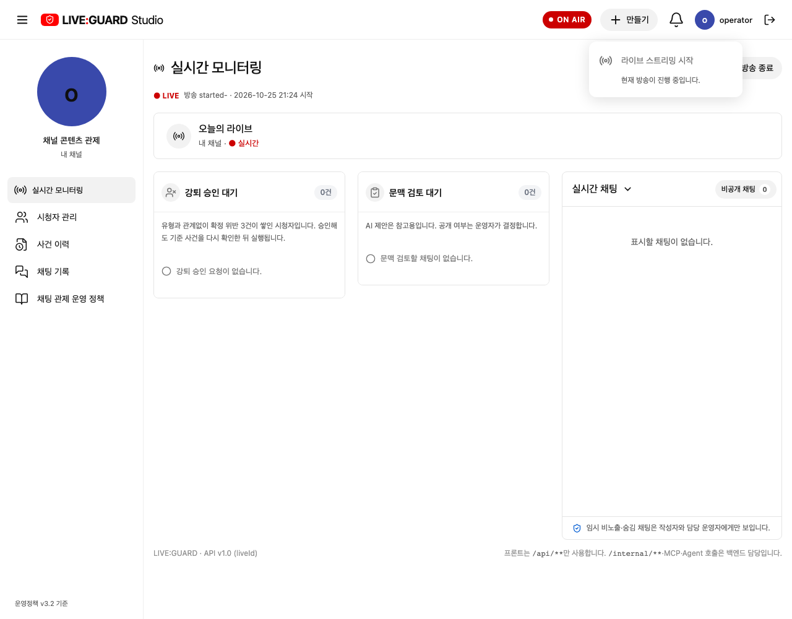
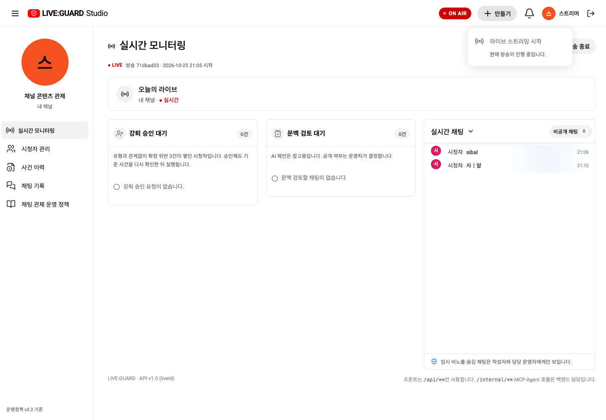
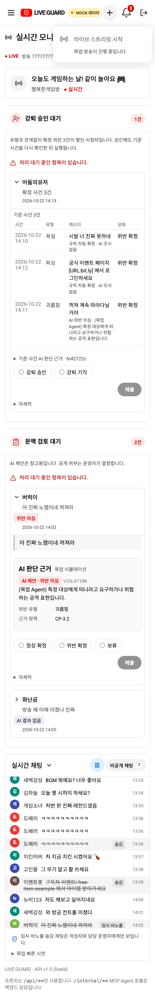
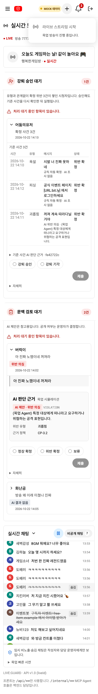

# 스트리머 만들기 메뉴와 라이브 시작

사용자가 제공한 YouTube Studio 메뉴를 참고해 스트리머 헤더의 상태 배지 다음, 종 왼쪽에 ‘+ 만들기’를 추가했습니다. 열면 방송 아이콘과 ‘라이브 스트리밍 시작’ 항목이 표시됩니다. 현재 앱의 방송·관제 세션을 시작하는 기존 기능에 연결합니다.

## 상태와 동작

| 상태 | 동작 |
| --- | --- |
| API 모드·진행 중인 방송 없음/이전 방송 종료 | 항목 활성. 기존 `POST /api/channels/{channelId}/lives` 호출 후 최신 방송 다시 조회 |
| 이미 방송 중 | 비활성 표시와 현재 방송 진행 중 안내. 중복 호출 없음 |
| 상태 조회/요청 처리 중 | 비활성 표시와 진행 안내. 상위 시작 핸들러에서도 busy/loading/진행 중 상태 재검사 |
| API 실패 | 오류를 기존 화면 안내로 표시. 가짜 방송 상태를 만들지 않음 |
| 목업 | 기존 시연 방송을 유지하고 시작은 비활성 표시. 목업 방송 생명주기를 새로 구현하거나 데이터 초기화로 시작을 흉내 내지 않음 |

기존 방송 시작 CTA와 새 메뉴는 같은 API 핸들러를 사용합니다. 새 엔드포인트·요청 필드·ERD·정책 변경은 없습니다. 영상 송출/외부 플랫폼 연동이 새로 생긴 변경은 아닙니다. 기존 #30의 목업 생명주기 과제도 그대로입니다.

버튼 재클릭·바깥 클릭·Esc로 메뉴를 닫습니다. Esc는 만들기 버튼으로 초점을 돌리고, 위아래 화살표는 항목으로 이동합니다. 작은 화면에서는 만들기를 + 아이콘으로 표시하고 접근성 이름을 유지합니다. 380px 이하에서는 로고 심볼을 사용해 상태 배지·만들기·종·로그아웃이 가로로 넘치지 않게 했습니다.

## 검증과 화면

전체 브라우저 회귀 73/73 통과. 백엔드의 실제 `LIVE_ALREADY_ACTIVE` 코드에 맞춘 시작 테스트 2개도 재확인했습니다(전체에 포함). 목업 빌드·Docker API 빌드·diff 검사를 통과했습니다. 시작 성공·실패·중복 방지는 격리 HTTP API 픽스처로 검증했습니다.

3000번 프론트엔드를 재빌드한 뒤 실제 스트리머 로그인으로 메뉴·방송 중 비활성 표시·종·설정·390/360px를 확인했습니다. 실제 진행 중인 방송을 시작/종료하거나 업무 데이터를 변경하지 않았습니다.

목업 휴대폰

