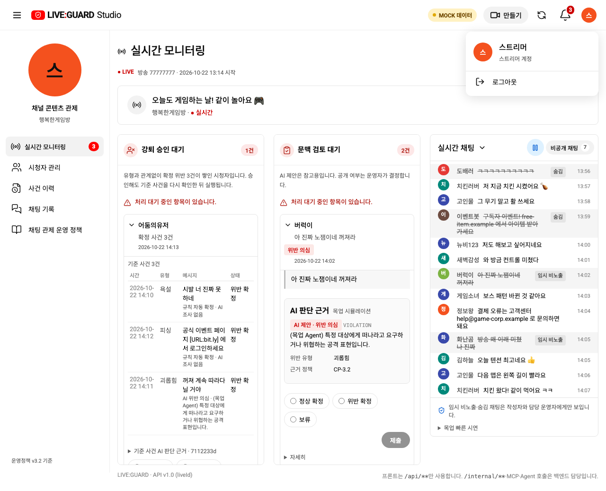
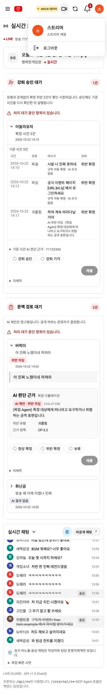
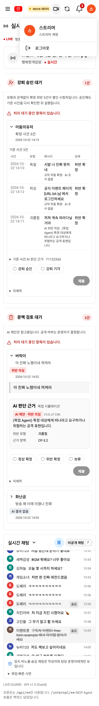
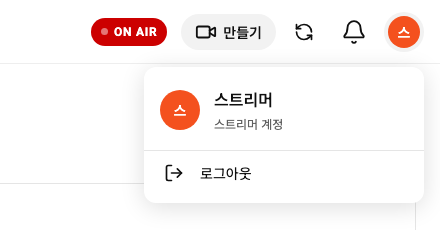

# 스트리머 계정 아이콘과 메뉴

사용자 제공 계정 메뉴를 참고해 스트리머 헤더에서 직접 보이던 닉네임·로그아웃을 제거했습니다. 프로필 아이콘을 누르면 현재 닉네임과 로그아웃 항목이 표시됩니다. 종은 계정 아이콘 바로 왼쪽에 유지합니다.

`AccountMenu.vue`가 현재 닉네임을 받아 기존 색상·이니셜로 계정 아이콘을 표시합니다. 메뉴에는 현재 닉네임·스트리머 계정 안내·기존 20px LogOut 아이콘과 로그아웃 행만 둡니다. 실제 API에 없는 이메일·핸들·Google 프로필 사진을 만들어내지 않고 Google 계정 관리/전환 기능도 추가하지 않습니다. 로그인·로그아웃 API와 권한·정책·ERD는 유지합니다.

## 조작

- 계정 아이콘 재클릭·바깥 클릭·Escape로 닫습니다. Escape는 아이콘으로 초점을 돌립니다.
- 메뉴를 열면 로그아웃 항목으로 키보드 초점이 이동합니다. 위아래 화살표로 항목을 선택하고 Enter로 기존 로그아웃을 실행합니다.
- 계정 아이콘은 휴대폰에서도 보입니다. 이전의 직접 프로필 아바타 숨김 규칙과 분리해 360·390px에서도 메뉴를 열 수 있습니다.
- 시청자·시스템 운영자의 헤더는 변경하지 않습니다. 기존 역할 전환 테스트는 스트리머일 때 계정 메뉴를 거쳐 로그아웃하도록 맞췄습니다.

## 목업 및 실제 API

목업 390·360px

3000번 프론트엔드만 재빌드하고 실제 스트리머로 로그인했습니다. 헤더 직접 닉네임·로그아웃 0개, 계정 메뉴 안의 닉네임·로그아웃 표시, 종/설정·만들기, 390/360px 가로 넘침 없음, 런타임 오류 없음을 확인했습니다. 방송·업무 데이터를 변경하지 않았습니다. 아래는 헤더·계정 메뉴 영역만 실제 캡처한 것입니다.

## 검증

집중 검사 4개에서 메뉴 열기·Escape 초점 복귀·모바일·목업 로그아웃과 기존 종/만들기를 확인했습니다. 최종 전체 브라우저 회귀 74/74, 목업 빌드·Docker API 빌드·diff 검사가 통과했습니다. 기존 SSE 배치 검사는 초기 전체 실행에서 주기 조회와 겹쳤고 단독 및 최종 전체 재실행에서 통과했습니다.
