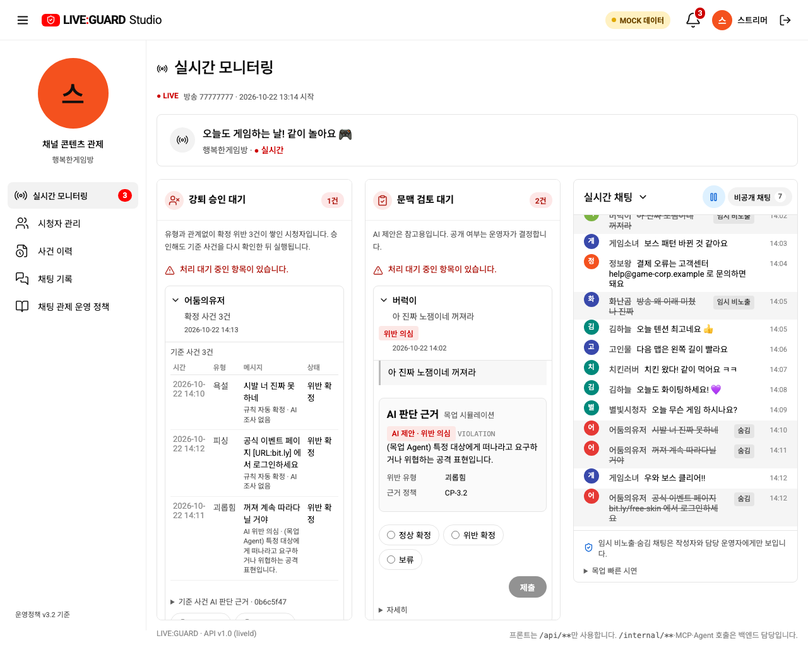
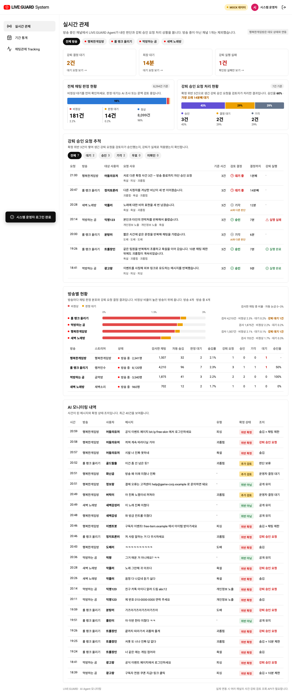
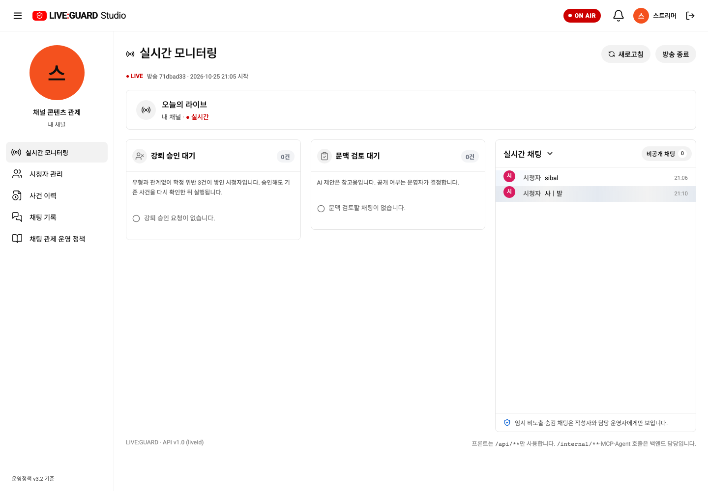
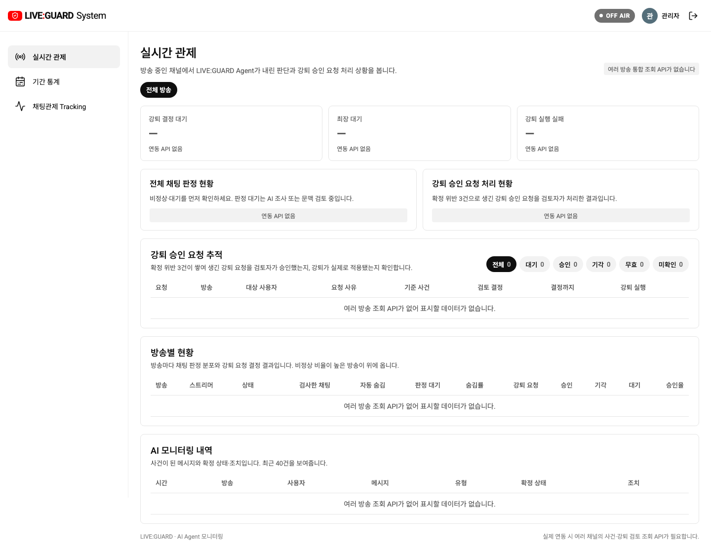
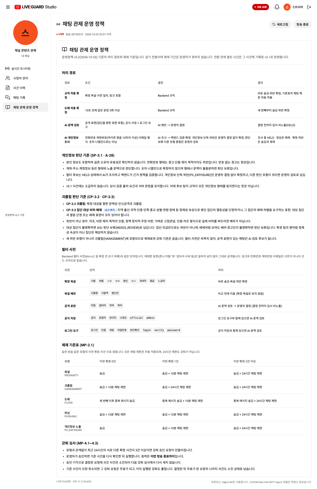
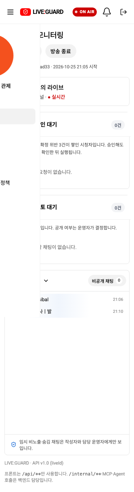

# YouTube Studio 참고 스타일 반영

사용자가 제공한 YouTube Studio 화면을 기준으로 스트리머·시스템 운영자의 시각적 틀을 실제로 변경했습니다. 참고 화면의 프로필 편집 기능을 추가하는 작업이 아니라 현재 관제 기능에 흰 작업 공간·절제된 테두리·메뉴·타이포그래피·간격을 적용한 변경입니다.

| 영역 | 이전 | 반영 |
| --- | --- | --- |
| 작업 공간·사이드바 | 회색 바탕과 진한 선택 면 | 흰 바탕, #eee 구분선, #f2f2f2 선택·호버 |
| 헤더 | 56px, 본문과 다소 붙은 구성 | 64px 헤더, 28px 본문 상단 간격. 휴대폰은 간격 축소 |
| 메뉴 | 46px 높이·굵은 글자 | 42px 높이·14px 본문·보통 굵기·검은 선 아이콘 |
| 프로필·방송 표시 | 게임패드 이모지 장식 | 실제 운영자 이름의 이니셜과 단색 방송 아이콘. 가짜 프로필 이미지를 만들지 않음 |
| 카드·대기열 | 둥근 테두리와 강퇴 카드의 분홍 면 | 8px 모서리, #e5e5e5 얇은 테두리, 흰 카드와 건수에 따른 회색·빨강 표시 |
| 근거·인용 | 보라색 인용선·옅은 색상 면 | 연회색 바탕과 얇은 구분으로 읽는 순서 정리 |
| 제목·본문 | 굵고 큰 제목 반복 | 페이지 24px/500, 영역 15–18px/500, 안내 #606060 |
| 시스템 운영자 | 별도 회색 틀 | 같은 흰 작업 공간·메뉴·카드·둥근 필터 버튼 규칙 |

강퇴→문맥→채팅 순서, 우상단 종·설정·처리 알림, 회색 OFF AIR, 공통 로그아웃, 새 요청 강조와 움직임 줄이기를 유지했습니다. 경고·판정 상태와 검증된 차트 색상은 유지합니다. 스타일은 `.studio-shell`·`.sys-shell`에 한정해 시청자 화면을 바꾸지 않습니다. API·정책·ERD·결정 요청 형식은 변경하지 않았습니다.

## 전후 및 실제 API 확인

[변경 전 3열 목업](https://github.com/skalaP05-03-261019/liveguard-fe/blob/bd1e042be4101f5d1eeaa2ec2463c84d350fcc95/docs/evidence/unified-monitoring/monitoring-three-columns.png)

3000번 프론트엔드만 Docker 재빌드·재시작했습니다. 실제 스트리머·시스템 운영자 로그인, 종 상세·설정·정책 페이지, 390·360px 가로 넘침 없음, ON AIR/회색 OFF AIR와 로그아웃 아이콘을 확인했습니다. 진행 중인 방송·업무 데이터를 변경하지 않았습니다.

정책 페이지·휴대폰

## 검증

집중 브라우저 검사 9개와 최종 전체 브라우저 회귀 71/71이 통과했습니다. 목업 빌드와 Docker API 빌드, `git diff --check`도 통과했습니다. 실제 API 화면은 실데이터 조회이며 검토 0건입니다. 목업의 신규 요청 효과·결정 카드 검증과 구분합니다.
