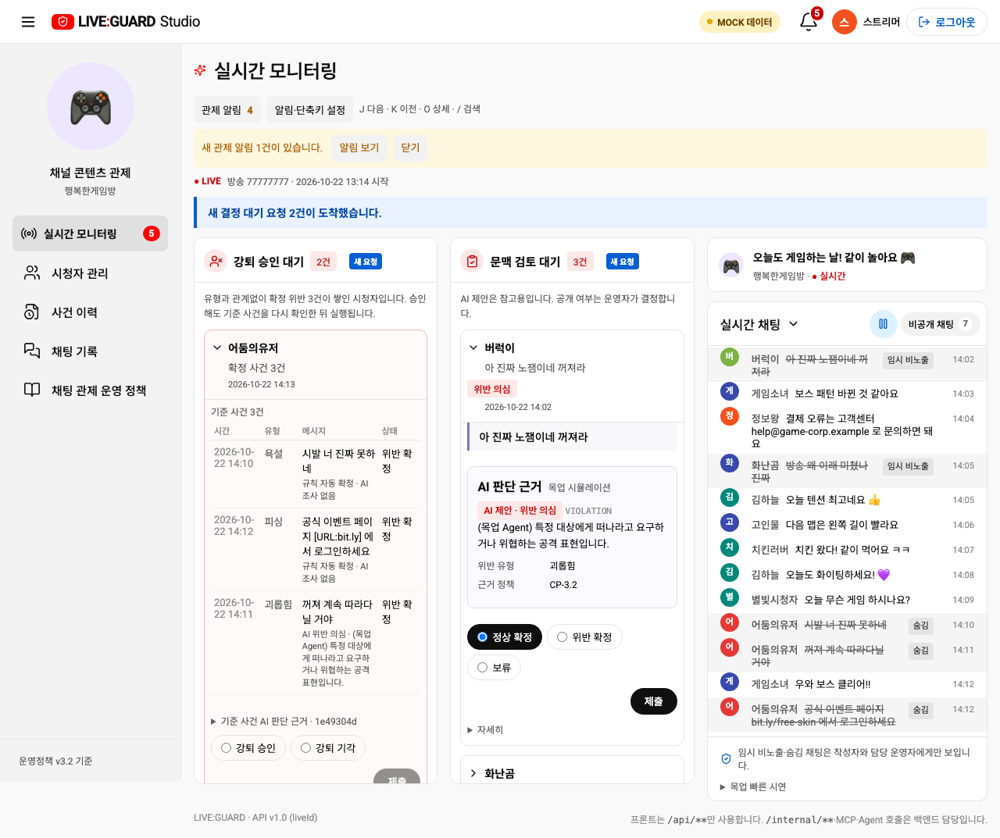
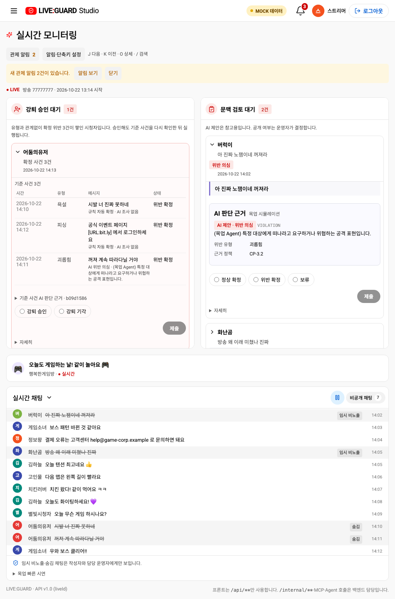
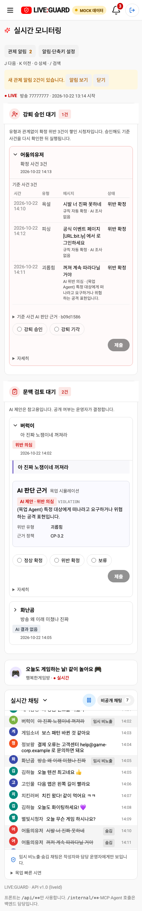
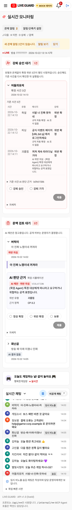

# 실시간 모니터링 3열 통합

실시간 채팅을 보던 운영자가 검토를 처리하려면 ‘결정 대기’ 메뉴로 이동하고, 다시 문맥/강퇴 탭을 골라야 했습니다. 방송을 보면서 두 종류의 요청을 함께 처리하도록 메뉴를 ‘실시간 모니터링’ 하나로 통합했습니다.

## 화면 구성

| 화면 | 배치 |
| --- | --- |
| 데스크톱 1200px 이상 | 왼쪽 강퇴 승인 대기 / 가운데 문맥 검토 대기 / 오른쪽 방송 정보·실시간 채팅 |
| 761–1199px | 강퇴·문맥을 위에 2열로 배치하고 채팅을 아래에 넓게 표시 |
| 760px 이하 | 강퇴 승인 → 문맥 검토 → 채팅 순서로 세로 배치 |

두 대기열은 각자 한 건씩 펼칩니다. 오래 기다린 순서는 유지하고, 요청이 와도 선택한 결정 값이나 초점을 바꾸지 않습니다. 데스크톱에서는 채팅과 각 대기열을 독립적으로 스크롤하며, 좁은 화면에서는 검토 내용이 페이지 흐름에 따라 펼쳐집니다. 강퇴의 기준 사건·근거·승인/기각 절차는 유지합니다.

종 알림에서 요청을 선택하면 통합 화면의 해당 열·카드를 열고 초점을 옮깁니다. J/K/O 탐색은 클릭하거나 초점을 둔 열에 적용하고, 별도 선택이 없으면 문맥 검토(없으면 강퇴)를 기본으로 합니다. 검색 단축키와 입력·IME 중 단축키 제외 규칙은 유지합니다.

## 새 요청 강조

- 새로운 PENDING reviewId에만 파란 테두리·완만한 등장 강조, NEW 배지, 해당 열의 ‘새 요청’ 표시와 상단 안내를 약 8초간 적용합니다.
- 초기 목록, 같은 요청의 version 갱신·재수신은 새 요청으로 취급하지 않습니다. 방송이 바뀌면 기준 목록을 다시 잡고 종료하면 효과·타이머를 정리합니다.
- 자동으로 카드를 펼치거나 스크롤·초점을 빼앗지 않습니다. 읽던 근거와 선택 중인 결정은 유지됩니다.
- `prefers-reduced-motion: reduce`에서는 이동·애니메이션을 끄고 정적 테두리·배지·문구로 알립니다. 자동 승인·기각·제재는 없습니다.

목업과 API 모드는 같은 UI를 사용합니다. 정책 v3.2, REST/SSE 스키마, 결정 요청 본문, ERD는 바꾸지 않습니다. 이번 변경에 실제 영상 송출 기능 추가는 포함하지 않습니다. 왼쪽 열은 기존 방송 정보와 채팅을 유지합니다.

## 증거와 검증

캡처는 목업이며 빈 상태는 격리 API 테스트 픽스처입니다. 새 테스트에서 3열 좌표, 1024/390/360px 가로 넘침·열 순서, 첫 로딩 효과 없음, 새 문맥·강퇴 효과, 선택·초점 유지, 효과 만료, 재수신 제외, 움직임 줄이기, API 빈 상태·방송 종료를 확인합니다. 기존 메뉴·탭 기반 테스트는 통합 화면에 맞게 바꾸되 결정 API 계약 검증은 유지했습니다. 최종 검증은 브라우저 71/71, 계약 4/4, 운영 도구 3/3으로 총 78개 통과했습니다. 목업·API 빌드와 `git diff --check`도 통과했습니다.

1024px

390·360px

움직임 줄이기·API 빈 상태

## OFF AIR 배지 후속 변경

최종 사용자 요청에 따라 OFF AIR를 ON AIR와 같은 둥근 배지·흰 점·글꼴·간격으로 맞추고 배경색만 회색(#707070)으로 변경했습니다. 이전 컬러바·검은 띠·고정폭 글꼴은 제거했습니다. 목업/API 공통 ModeBadge 스타일을 사용하며 MOCK 데이터 표시는 유지합니다. 3000번 Docker도 다시 빌드하고 실제 API 화면을 확인합니다.

