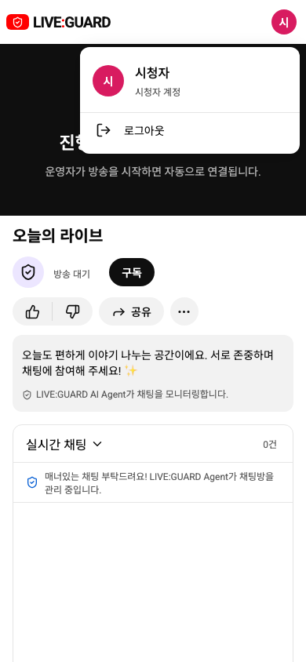
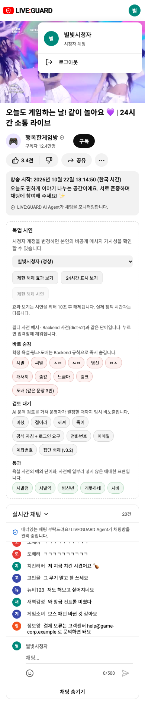

# 시청자 헤더 계정 메뉴

시청자 화면 오른쪽 위 ON AIR/OFF AIR 상태 배지와 직접 노출된 로그아웃 버튼을 제거했습니다. 계정 아이콘을 누르면 현재 닉네임, 시청자 계정 설명, 로그아웃이 표시됩니다. 스트리머·관리자와 공용 AccountMenu를 사용하며 Google 인증 API나 계정 사진을 새로 연동하지 않습니다.

목업/API 모두 ViewerScreen을 공유하여 적용됩니다. 실제 방송 상태·채팅·방송 대기 안내는 기존대로 동작합니다. 계정 메뉴는 Esc·외부 클릭으로 닫을 수 있고 Esc는 계정 버튼으로 초점을 돌립니다.

## 화면

실제 localhost:3000 API 콘솔(방송 대기 중):

목업:

## 검증

- 프로덕션 빌드와 diff 검사 통과. Docker frontend 재빌드로 3000번 반영.
- 관련 브라우저 테스트 4/4 통과: 목업/API 시청자 계정 메뉴(1280·390·360px, Esc 초점 복귀, 로그아웃), 기존 시청자 화면 동일 배치, 관리자 상태 배지 제거 반영.
- 실제 API 로그인으로 헤더 상태 배지 0개·직접 로그아웃 버튼 0개, 계정 메뉴에서 로그아웃 동작 확인.
- 이번 변경 후 전체 테스트 재실행은 하지 않았으며, 위 변경 관련 테스트를 실행했습니다.
