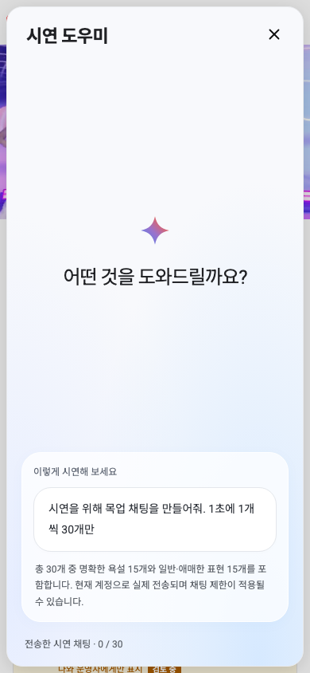
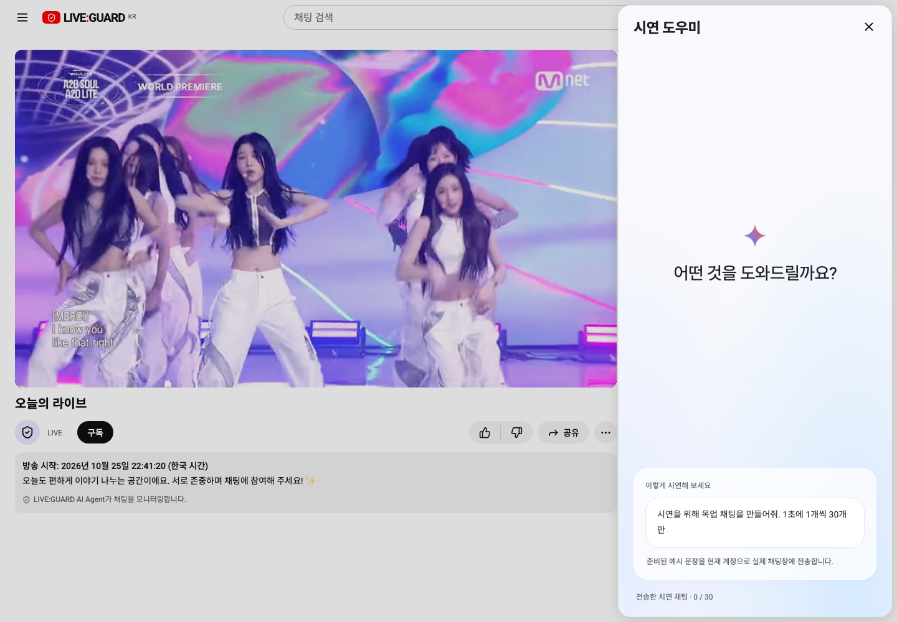

# 시청자 시연 채팅 도우미

검색창 오른쪽의 기존 마이크 자리에 있는 Gemini 모양 아이콘을 누르면 오른쪽에 ‘어떤 것을 도와드릴까요?’ 패널이 열립니다. ‘시연을 위해 목업 채팅을 만들어줘. 1초에 1개씩 30개만’ 버튼은 **실제 시청자 채팅창으로 시연 문장을 전송**합니다. 이전 패널 안 미리보기 구현은 이 동작으로 교체했습니다.

## 전송 방식

API 모드에서는 로그인한 시청자 계정으로 기존 `sendLive` 채팅 API를 호출합니다. 목업에서는 기존 `store.sendMessage`를 사용합니다. 판정·채팅 제한·SSE 반영은 일반 채팅과 같은 경로를 따릅니다. 임의로 다른 시청자 계정을 만들거나 클라이언트에서 정상 판정을 만들지 않습니다. 문장에 `[시연 n/30]`을 붙여 시연임을 표시하며 작성 중인 초안은 건드리지 않습니다.

첫 전송은 1초 후이며, 1초 간격 타이머에서 최대 1건씩 전송합니다. 이전 요청이 끝나지 않았다면 해당 tick을 건너뛰어 중복/밀린 요청 폭주를 막으므로 서버가 느리면 완료까지 30초 이상 걸릴 수 있습니다. 성공한 전송만 건수로 셉니다. 최대 30건 후 종료하며 실패는 자동 재시도하지 않습니다.

Gemini API 연동은 현재 없습니다. 준비된 예시 문장을 사용한다고 패널에 명시했습니다. 실제 Gemini 생성이 필요하면 서버 측 생성 API와 키 관리가 추가로 필요합니다. 이번 변경에 API·ERD·정책 변경이나 브라우저 비밀키는 없습니다.

## 중단과 상태

방송이 없거나 채팅 제한·강퇴·방송 종료 상태이면 실행할 수 없습니다. 실행 중 동일한 상태로 바뀌거나 API가 실패하면 중단합니다. 생성 중지·패널 닫기·계정/방송 범위 변경·화면 해제도 후속 전송을 취소합니다. 이미 서버로 보낸 요청은 취소/삭제하지 않습니다. 패널에는 성공한 전송 내역과 중단 이유를 표시합니다.

## 캡처

목업: 실제 채팅 목록으로 전송 완료(패널은 전송 내역)

실제 localhost:3000 채팅창:

## 검증

- 프로덕션 빌드 및 Docker frontend 재빌드.
- 관련 브라우저 테스트 **3/3 통과**: 목업/API의 초당 1개·총 30개·API POST 30회·실제 채팅 목록 반영·작성 중 초안 유지·중복 방지·재실행·중지/닫기·모바일. API 실패/방송 종료 중단과 방송 없음 비활성화 확인.
- 전체 회귀 테스트는 이번 변경 후 실행하지 않았습니다.
- 실제 localhost:3000에서 시청자 계정으로 시연 채팅 30건 전송 완료 후 재로그인하여 마지막 `[시연 30/30]` 채팅을 확인했습니다. 실제 방송 시작/종료는 변경하지 않았습니다.

## 도우미 패널 디자인 개편

참고 이미지처럼 여백이 있는 중앙 인사말, 별 아이콘, 하단의 둥근 제안 카드와 파란 그라데이션으로 정리했습니다. 헤더의 Gemini 글자는 제거하고 ‘시연 도우미’를 데스크톱 23px/모바일 22px로 크게 표시합니다. 기존 실제 채팅 전송 안내·건수·중지·실패 메시지는 유지합니다. 동작 중에는 인사말을 줄여 전송 내역 공간을 확보합니다.

디자인 변경 후 프로덕션 빌드, 관련 브라우저 테스트 3/3, localhost:3000 frontend 재빌드 및 실제 데스크톱/390px 표시 확인을 완료했습니다. 이번 실제 화면 확인에서는 채팅을 추가 전송하지 않았습니다.

## 시연 문장 구성

30개 문장을 고정 목록으로 구성했습니다. 일반 대화 다음에 예외 단어 ‘시발점’, 애매한 ‘아 개못하네’, 긍정적 감탄 ‘와 미쳤다 … 멋있다’, 상대를 향한 ‘너 진짜 미쳤냐 …’·‘게임 접어라 …’, 마지막에 명확한 욕설 ‘아 씨발 진짜 못하네’를 포함합니다. 명확한 욕설은 제재로 앞선 시연이 끊기지 않도록 마지막에 배치했으며, 어느 문장이든 기존 판정·제재를 그대로 적용합니다. 실제 API에서 동일한 판정 결과를 보장하거나 강제하지 않습니다.

패널에도 욕설·문맥 검토 예시 포함 및 실제 계정 제재 가능성을 안내합니다. 이번 변경으로 실제 API 콘솔에 욕설을 자동 전송하는 검증은 하지 않았습니다. 격리 API 및 목업에서 전송과 숨김·문맥 검토 표시를 검증했습니다.

## 욕설 예시 15개로 확대

최신 목록은 **명확한 욕설 15개 + 일반·애매한 표현 15개**입니다. 앞서 설명한 ‘명확한 욕설은 마지막 한 건’ 구성을 대체합니다. 16번째부터 ‘씨발’, ‘시발’, ‘병신’, ‘ㅅㅂ’ 등을 포함한 서로 다른 문장을 넣었습니다. 별도 계정으로 바꾸거나 제한을 풀지 않으므로 실제 정책상 제재가 발생하면 총 30건 전에 중단될 수 있습니다. 패널 안내에도 개수를 표시합니다.

관련 브라우저 테스트 3/3 통과: API fixture는 30건 전달, 목업은 욕설 누적에 따른 숨김·제한 중단을 확인했습니다. 프로덕션 빌드, 3000번 frontend 재빌드와 새 안내 표시 확인 완료. 이번 검증에서는 실제 API에 추가 욕설을 전송하지 않았습니다.
