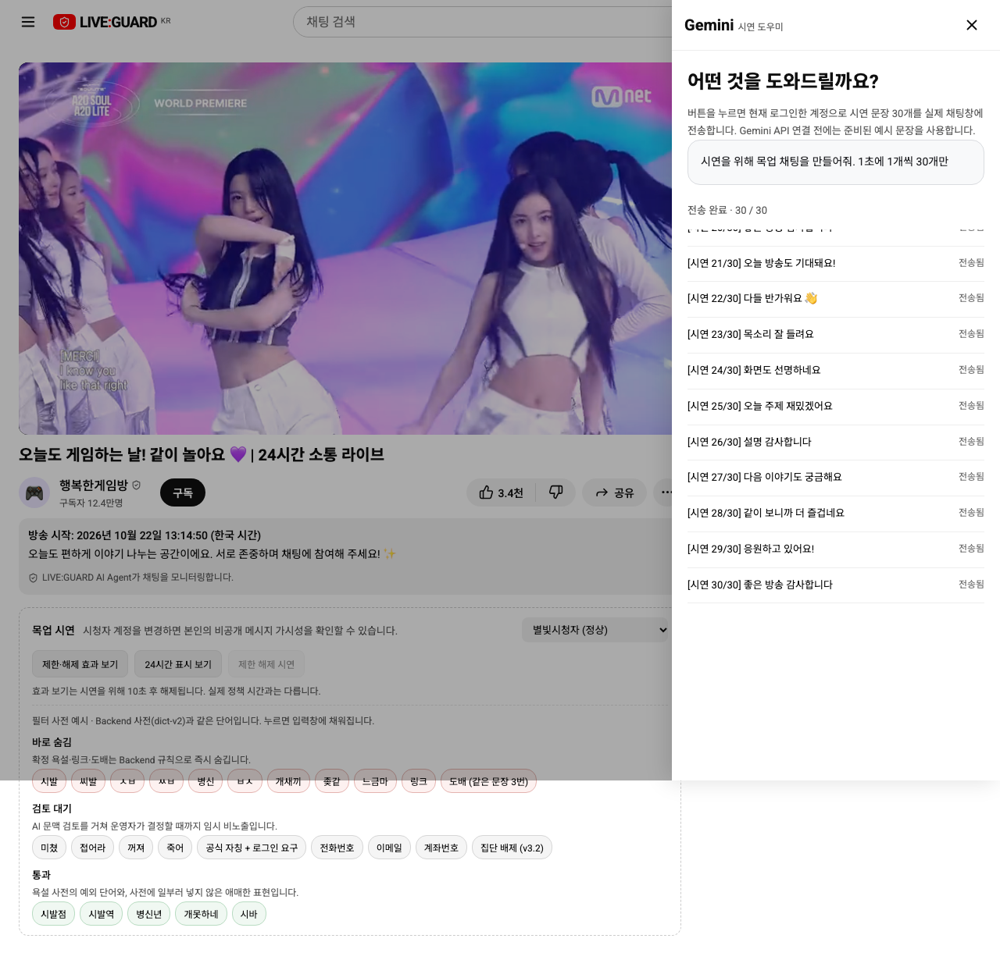
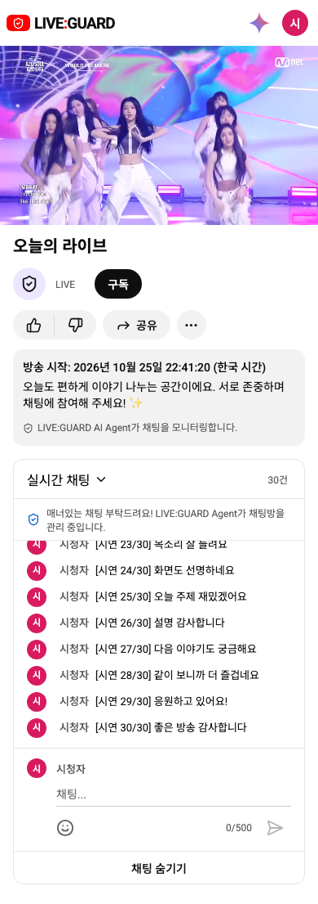

# 시청자 시연 채팅 도우미

검색창 오른쪽의 기존 마이크 자리에 있는 Gemini 모양 아이콘을 누르면 오른쪽에 ‘어떤 것을 도와드릴까요?’ 패널이 열립니다. ‘시연을 위해 목업 채팅을 만들어줘. 1초에 1개씩 30개만’ 버튼은 **실제 시청자 채팅창으로 시연 문장을 전송**합니다. 이전 패널 안 미리보기 구현은 이 동작으로 교체했습니다.

## 전송 방식

API 모드에서는 로그인한 시청자 계정으로 기존 `sendLive` 채팅 API를 호출합니다. 목업에서는 기존 `store.sendMessage`를 사용합니다. 판정·채팅 제한·SSE 반영은 일반 채팅과 같은 경로를 따릅니다. 임의로 다른 시청자 계정을 만들거나 클라이언트에서 정상 판정을 만들지 않습니다. 문장에 `[시연 n/30]`을 붙여 시연임을 표시하며 작성 중인 초안은 건드리지 않습니다.

첫 전송은 1초 후이며, 1초 간격 타이머에서 최대 1건씩 전송합니다. 이전 요청이 끝나지 않았다면 해당 tick을 건너뛰어 중복/밀린 요청 폭주를 막으므로 서버가 느리면 완료까지 30초 이상 걸릴 수 있습니다. 성공한 전송만 건수로 셉니다. 최대 30건 후 종료하며 실패는 자동 재시도하지 않습니다.

Gemini API 연동은 현재 없습니다. 준비된 예시 문장을 사용한다고 패널에 명시했습니다. 실제 Gemini 생성이 필요하면 서버 측 생성 API와 키 관리가 추가로 필요합니다. 이번 변경에 API·ERD·정책 변경이나 브라우저 비밀키는 없습니다.

## 중단과 상태

방송이 없거나 채팅 제한·강퇴·방송 종료 상태이면 실행할 수 없습니다. 실행 중 동일한 상태로 바뀌거나 API가 실패하면 중단합니다. 생성 중지·패널 닫기·계정/방송 범위 변경·화면 해제도 후속 전송을 취소합니다. 이미 서버로 보낸 요청은 취소/삭제하지 않습니다. 패널에는 성공한 전송 내역과 중단 이유를 표시합니다.

## 캡처

목업: 실제 채팅 목록으로 전송 완료(패널은 전송 내역)

실제 localhost:3000 채팅창:

## 검증

- 프로덕션 빌드 및 Docker frontend 재빌드.
- 관련 브라우저 테스트 **3/3 통과**: 목업/API의 초당 1개·총 30개·API POST 30회·실제 채팅 목록 반영·작성 중 초안 유지·중복 방지·재실행·중지/닫기·모바일. API 실패/방송 종료 중단과 방송 없음 비활성화 확인.
- 전체 회귀 테스트는 이번 변경 후 실행하지 않았습니다.
- 실제 localhost:3000에서 시청자 계정으로 시연 채팅 30건 전송 완료 후 재로그인하여 마지막 `[시연 30/30]` 채팅을 확인했습니다. 실제 방송 시작/종료는 변경하지 않았습니다.
